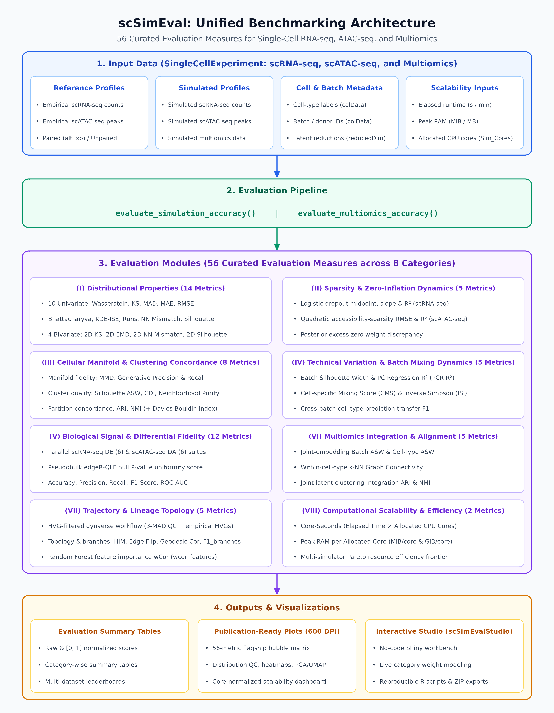

# scSimEval: Unified Benchmarking and Accuracy Evaluation for Single-Cell Multiomics Simulation Methods <a href="https://kabilanbio.github.io/scSimEval/"></a>

[](https://opensource.org/licenses/MIT)
[](https://kabilanbio.github.io/scSimEval/)
[](https://github.com/BiocStaging/scSimEval)

---

## Overview

**`scSimEval`** is a unified evaluation and benchmarking toolkit designed to systematically quantify how faithfully single-cell and multiomics simulation methods reproduce empirical biological experiments.

The package provides a standardized, reference-based benchmarking framework computing **56 curated evaluation measures organized into 8 foundational categories**:

1. **Category I: Distributional Properties (14 Metrics)** — Univariate and bivariate distribution distances across cell- and feature-level statistical moments.
2. **Category II: Sparsity & Zero-Inflation Dynamics (4 Metrics)** — Logistic dropout curves (scRNA-seq), accessibility-sparsity curves (scATAC-seq), and posterior excess zero weights.
3. **Category III: Cellular Manifold & Clustering Concordance (8 Metrics)** — Global manifold fidelity (MMD), local topology coverage (Generative Precision & Recall), Cluster Silhouette ASW, Clustering Deviation Index (CDI), Neighborhood Purity, Adjusted Rand Index (ARI), and Normalized Mutual Information (NMI).
4. **Category IV: Technical Variation & Batch Mixing Dynamics (5 Metrics)** — Batch Silhouette ASW, PC Regression $R^2$ (PCR), Cell-Specific Mixing Score (CMS), Inverse Simpson Index (ISI / LISI), and Cross-Batch cell-type classification transfer F1.
5. **Category V: Biological Signal & Differential Fidelity (6 Metrics per modality)** — Pseudobulk `edgeR-QLF` models across biological replicates evaluating DE and DA null $p$-value uniformity, accuracy, precision, recall, F1-score, and ROC-AUC.
6. **Category VI: Multiomics Integration & Alignment (5 Metrics)** — Cross-modal alignment in shared latent space via joint Batch ASW, Cell-Type ASW, $k$-NN Graph Connectivity, Integration ARI, and Integration NMI (*active for Paired and Unpaired Multiomics*).
7. **Category VII: Trajectory & Lineage Topology (5 Metrics)** — Dynverse lineage benchmark evaluating HIM topology similarity, edge-flip distance, geodesic correlation, branch assignment F1, and Random Forest feature importance-weighted correlation (`wcor_features`).
8. **Category VIII: Computational Scalability & Efficiency (2 Metrics)** — Standardized core-normalized execution runtime (`core_seconds`) and resident memory footprint per core (`memory_per_core_mib`).

### Supported Operational Modalities
* **`scRNA-seq`** (Unimodal Transcriptome: **45 metrics** across 7 categories)
* **`scATAC-seq`** (Unimodal Epigenome / Chromatin Accessibility: **32 metrics** across 6 categories)
* **`Paired Multiomics`** (Simultaneous Co-assay, e.g., 10x Chromium Multiome, SHARE-seq: **all 56 metrics** across all 8 canonical categories)
* **`Unpaired Multiomics`** (Independent Biological Specimens: **53 metrics** across 7 categories)

<p align="center">
  
</p>

---

## Installation

Install the development version of **`scSimEval`** from GitHub using `remotes`:

```R
if (!requireNamespace("remotes", quietly = TRUE)) {
  install.packages("remotes")
}

remotes::install_github("kabilanbio/scSimEval")
```

---

## Execution Options: Interactive Shiny Studio & Reproducible R Script

`scSimEval` supports two distinct, flexible execution workflows tailored for both interactive exploratory analysis and large-scale computational pipelines:

### Option 1: Interactive Shiny App Studio (`scSimEvalApp`)
For interactive graphical exploration, `scSimEval` provides an all-in-one, no-code web studio directly within R:
* **Interactive Upload & Validation:** Automated file format checking, metadata alignment, and assay detection.
* **Comparative Visualizations:** Live generation of 600 DPI publication-grade plots including Comparative Bubble Matrices, Category Radar Charts, Heatmaps, Boxplots, and Multi-Simulator UMAP/PCA Embeddings.
* **Filter & Leaderboard Exploration:** Real-time simulator rank ordering, metric selection, and Excel/CSV summary report exports.

Launch the Shiny studio directly from your R console:
```R
library(scSimEval)
launch_scSimEval_app()
```

### Option 2: Standalone & Headless R Script (Workstations & HPC Clusters)
For large-scale, automated, or compute-intensive benchmarking on multi-core workstations and High-Performance Computing (HPC) clusters:
* **Download Pre-Configured R Script:** In the Shiny app **Data Hub**, clicking **"Download R Script"** automatically generates a complete, self-contained, and procedural R workflow script pre-populated with your exact dataset paths, metadata columns, and core settings.
* **Headless Command-Line Execution:** Run directly in batch scripts or via R without launching a browser or consuming graphical display resources:
  ```R
  library(scSimEval)

  # Run full benchmark evaluation headlessly
  benchmark_results <- evaluate_simulation_accuracy(
    ref_data   = reference_counts,
    sim_data   = simulated_counts,
    cell_types = cell_type_annotations,
    batch_info = batch_annotations,
    threads    = 4,
    verbose    = TRUE
  )

  # Save results object
  saveRDS(benchmark_results, "scSimEval_benchmark_results.rds")
  ```

---

## Authors

`scSimEval` is developed and maintained at the **Division of Agricultural Bioinformatics, ICAR-Indian Agricultural Statistics Research Institute (ICAR-IASRI)**, New Delhi, India:

- **Kabilan Sakthivel** (Maintainer & Ph.D Scholar) — `kabilan151414@gmail.com`
- **Dr. Dwijesh Chandra Mishra** (Principal Scientist & Thesis Guide) — `dwij.mishra@gmail.com`
- **Dr. Shashi Bhushan Lal** (Principal Scientist) — `sblall16@gmail.com`
- **Dr. Ulavappa Angadi** (Principal Scientist) — `ubaangadi.iasri@icar.org.in`
- **Dr. Sudhir Srivastava** (Senior Scientist) — `sudhir0401bm@gmail.com`
- **Dr. Neeraj Budhlakoti** (Senior Scientist) — `neeraj35669@gmail.com`
- **Dr. Krishna Kumar Chaturvedi** (Principal Scientist) — `kkcchaturvedi@gmail.com`
- **Dr. Ranjeet Ranjan Kumar** (Senior Scientist) — `ranjeetranjaniari@gmail.com`
- **Dr. Navin Chandra Gupta** (Senior Scientist) — `navinbtc@gmail.com`
- **Dr. Sharanbasappa** (Scientist) — `smadival509@gmail.com`

- **Bug Reports & Issues:** [https://github.com/kabilanbio/scSimEval/issues](https://github.com/kabilanbio/scSimEval/issues)
