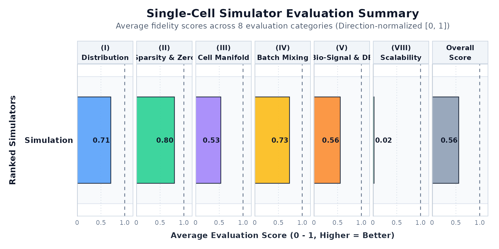
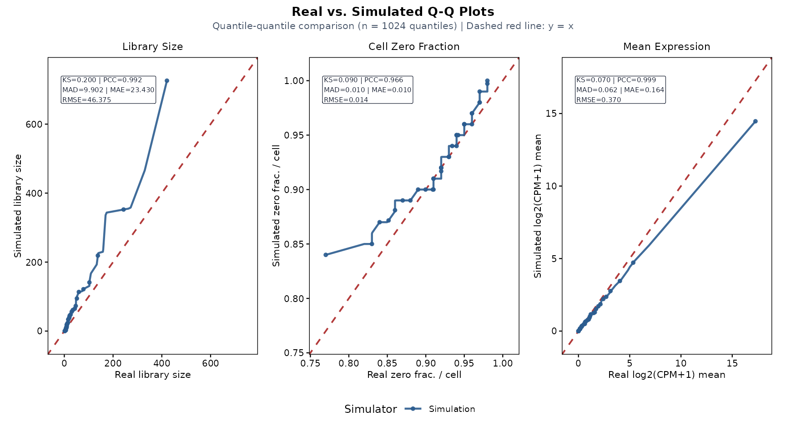

# Getting Started with scSimEval: Benchmarking Single-Cell Simulations in Bioconductor

## Overview & Bioconductor Ecosystem Integration

**`scSimEval`** provides a unified, standardized benchmarking suite to
evaluate how closely synthetic single-cell datasets reproduce empirical
biological references across **scRNA-seq**, **scATAC-seq**, and
**paired/unpaired single-cell multiomics**.

### Integration with Existing Bioconductor Infrastructure

`scSimEval` is built directly on Bioconductor core data structures and
statistical infrastructure:

- **Data representation**: Accepts `SingleCellExperiment` (and
  multi-modal `SingleCellExperiment` objects with
  [`altExp()`](https://rdrr.io/pkg/SingleCellExperiment/man/altExps.html)),
  reading cell-type (`cell_type`) and replicate/batch (`batch`)
  annotations directly from
  [`SummarizedExperiment::colData()`](https://rdrr.io/pkg/SummarizedExperiment/man/SummarizedExperiment-class.html).
  Users starting from Seurat objects can convert in one line via
  [`Seurat::as.SingleCellExperiment()`](https://satijalab.org/seurat/reference/as.SingleCellExperiment.html).
- **Parallel & sparse execution**: Uses `BiocParallel` and `Matrix`
  sparse S4 methods for scalable memory-efficient evaluation.
- **Downstream statistical engines**: Integrates with `edgeR`
  (pseudobulk quasi-likelihood differential expression/accessibility),
  `CDI` (Clustering Deviation Index), `scater` and `scuttle` (QC and
  normalization utilities), and `CellMixS` (cell-specific batch mixing).

### Comparison with Related Bioconductor Packages

- **`splatter`**: Primarily focuses on simulating scRNA-seq count
  matrices (e.g., Splat, Lun, Simple models) and provides basic property
  comparisons via `compareSCEs()`. `scSimEval` complements `splatter` by
  serving as a **simulator-agnostic evaluator** that benchmarks any
  simulator output across **56 metrics** in **8 categories**—spanning
  distributional distances, dropout/sparsity curves, clustering
  concordance, batch mixing, pseudobulk differential fidelity,
  trajectory topology, cross-modal integration, and hardware-normalized
  scalability.
- **`countsimQC`**: Generates visual comparisons of distributional
  summaries between synthetic and real count matrices (primarily bulk or
  unimodal RNA-seq). `scSimEval` extends beyond marginal count QC to
  assess **single-cell downstream structure** (clustering ARI/NMI/CDI,
  batch PCR/CMS/ISI, pseudobulk DEG/DA ROC-AUC, scATAC-seq TF-IDF
  accessibility, paired/unpaired RNA+ATAC integration, and
  `core_seconds` / `memory_per_core_mib` efficiency).

------------------------------------------------------------------------

## Input Data Format

All top-level `scSimEval` evaluation entry points center on
**`SingleCellExperiment`** objects containing raw counts
(`assays(sce)$counts`) and cell metadata columns (`cell_type` and
`batch` in `colData(sce)`):

``` r
# Optional conversion if starting from Seurat:
# ref_sce <- Seurat::as.SingleCellExperiment(ref_seurat)
# sim_sce <- Seurat::as.SingleCellExperiment(sim_seurat)
```

For multiomics studies, pass either a named list
`list(RNA = rna_sce, ATAC = atac_sce)` or a single
`SingleCellExperiment` containing the secondary assay in
`altExp(sce, "ATAC")`.

------------------------------------------------------------------------

## Quick-Start Tutorial (Unimodal scRNA-seq)

First, load `scSimEval` and the bundled `example_scrna` dataset (`ref`
and `sim` are `SingleCellExperiment` objects with `cell_type` and
`batch` already stored in `colData`):

``` r
library(scSimEval)
library(SingleCellExperiment)

data("example_scrna", package = "scSimEval")
example_scrna$ref
#> class: SingleCellExperiment 
#> dim: 100 100 
#> metadata(0):
#> assays(1): counts
#> rownames(100): Os04g0188433 Os05g0202800 ... Os06g0553200 Os04g0578600
#> rowData names(0):
#> colnames(100): AAACCGGCAAGTGTTT-1 AAACGGATCGATCAGT-1 ...
#>   TTTGGTGCATGTCAGC-1 TTTGTGTTCATAACGC-1
#> colData names(2): cell_type batch
#> reducedDimNames(1): PCA
#> mainExpName: NULL
#> altExpNames(0):
head(colData(example_scrna$ref), 3)
#> DataFrame with 3 rows and 2 columns
#>                          cell_type    batch
#>                           <factor> <factor>
#> AAACCGGCAAGTGTTT-1 Parenchyma_cell   Bud_21
#> AAACGGATCGATCAGT-1 Parenchyma_cell   Bud_21
#> AACAGCAAGGTTAGAG-1 Epidermis         Bud_21
```

Run
[`evaluate_simulation_accuracy()`](https://kabilanbio.github.io/scSimEval/reference/evaluate_simulation_accuracy.md)
on `ref_sce` and `sim_sce`. Here we include timing and memory metadata
to compute Category VIII scalability metrics
(`compute_bivariate = FALSE` and `include_trajectory = FALSE` keep this
quick-start vignette fast):

``` r
scrna_res <- evaluate_simulation_accuracy(
  ref_sce            = example_scrna$ref,
  sim_sce            = example_scrna$sim,
  cell_type_col      = "cell_type",
  batch_col          = "batch",
  modality           = "scRNA-seq",
  compute_bivariate  = FALSE,
  include_trajectory = FALSE,
  elapsed_time       = 12.4,
  memory_mb          = 420,
  sim_cores          = 2L,
  threads            = 1L,
  verbose            = FALSE
)

head(scrna_res$metrics_summary_table, 10)
#>                     Category     Property                      Metric
#> 1  Distributional Properties library_size                 Wasserstein
#> 2  Distributional Properties library_size                          KS
#> 3  Distributional Properties library_size                         MAD
#> 4  Distributional Properties library_size               Bhattacharyya
#> 5  Distributional Properties library_size              Runs_Statistic
#> 6  Distributional Properties library_size                 NN_Mismatch
#> 7  Distributional Properties library_size Between_Dataset_Silh_Global
#> 8  Distributional Properties library_size                         MAE
#> 9  Distributional Properties library_size                        RMSE
#> 10 Distributional Properties library_size                     KDE_ISE
#>          Value Sim_Cores
#> 1  22.87000000         2
#> 2   0.20000000         2
#> 3  10.00000000         2
#> 4   0.00564741         2
#> 5  -2.83556062         2
#> 6   0.06500000         2
#> 7   0.02451093         2
#> 8  22.87000000         2
#> 9  45.22554588         2
#> 10  0.00123334         2
```

### Visualizing Results

We can summarize overall category scores or inspect distributional Q-Q /
density concordance directly from the returned evaluation object:

``` r
plot_evaluation_summary(scrna_res)
```



``` r
plot_distribution_qc(
  ref_data   = example_scrna$ref,
  sim_data   = example_scrna$sim,
  layout     = "qq",
  properties = c("library_size", "zero_fraction_cell", "mean_expression")
)
```



------------------------------------------------------------------------

## Quick-Start Tutorial (Paired Multiomics: scRNA-seq + scATAC-seq)

For simultaneous co-assay simulations,
[`evaluate_multiomics_accuracy()`](https://kabilanbio.github.io/scSimEval/reference/evaluate_multiomics_accuracy.md)
jointly evaluates both unimodal layers plus Category VI cross-modal
alignment:

``` r
data("example_multiomics", package = "scSimEval")

multi_res <- evaluate_multiomics_accuracy(
  ref_multi    = example_multiomics$ref_multi,
  sim_multi    = example_multiomics$sim_multi,
  pairing      = "paired",
  elapsed_time = 28.5,
  memory_mb    = 1024,
  sim_cores    = 2L,
  threads      = 1L,
  verbose      = FALSE
)

table(multi_res$benchmark_summary_table$Category)
#> 
#>       (VI) Multiomics Integration & Alignment 
#>                                             5 
#>           (VII) Trajectory & Lineage Topology 
#>                                             5 
#> (VIII) Computational Scalability & Efficiency 
#>                                             2 
#>     Biological Signal & Differential Fidelity 
#>                                            12 
#>    Cellular Manifold & Clustering Concordance 
#>                                            16 
#>                     Distributional Properties 
#>                                           270 
#>            Sparsity & Zero-Inflation Dynamics 
#>                                             7 
#>   Technical Variation & Batch Mixing Dynamics 
#>                                            10
```

We can also compute normalized scores (`[0, 1]`, where `1` is best) via
[`normalize_bubble_scores()`](https://kabilanbio.github.io/scSimEval/reference/normalize_bubble_scores.md)
and summarize multiple simulators with
[`plot_benchmark_bubble_matrix()`](https://kabilanbio.github.io/scSimEval/reference/plot_benchmark_bubble_matrix.md).

------------------------------------------------------------------------

## Further Reading & Interactive GUI

- **Complete 56-Metric Reference**: See
  [`vignette("metrics-catalog", package = "scSimEval")`](https://kabilanbio.github.io/scSimEval/articles/metrics-catalog.md)
  for definitions, formulas, and optimization directions for every
  measure across Categories I–VIII.
- **Domain Case Studies**: See the scRNA-seq, scATAC-seq, paired
  multiomics, unpaired multiomics, and `.rds` aggregation vignettes.
- **Interactive Shiny Interface**: Point-and-click dataset exploration,
  dynamic filtering, and high-resolution report exports are available in
  the companion package **`scSimEvalStudio`**
  ([`scSimEvalStudio::launch_scSimEval_app()`](https://kabilanbio.github.io/scSimEvalStudio/reference/launch_scSimEval_app.html)).

------------------------------------------------------------------------

## Session Information

``` r
sessionInfo()
#> R version 4.6.2 (2026-10-29)
#> Platform: x86_64-pc-linux-gnu
#> Running under: Ubuntu 24.04.5 LTS
#> 
#> Matrix products: default
#> BLAS:   /usr/lib/x86_64-linux-gnu/blas/libblas.so.3.12.0 
#> LAPACK: /usr/lib/x86_64-linux-gnu/lapack/liblapack.so.3.12.0  LAPACK version 3.12.0
#> 
#> locale:
#>  [1] LC_CTYPE=en_US.UTF-8       LC_NUMERIC=C              
#>  [3] LC_TIME=en_US.UTF-8        LC_COLLATE=en_US.UTF-8    
#>  [5] LC_MONETARY=en_US.UTF-8    LC_MESSAGES=en_US.UTF-8   
#>  [7] LC_PAPER=en_US.UTF-8       LC_NAME=C                 
#>  [9] LC_ADDRESS=C               LC_TELEPHONE=C            
#> [11] LC_MEASUREMENT=en_US.UTF-8 LC_IDENTIFICATION=C       
#> 
#> time zone: Asia/Kolkata
#> tzcode source: system (glibc)
#> 
#> attached base packages:
#> [1] stats4    stats     graphics  grDevices utils     datasets  methods  
#> [8] base     
#> 
#> other attached packages:
#>  [1] SingleCellExperiment_1.34.0 SummarizedExperiment_1.42.0
#>  [3] Biobase_2.72.0              GenomicRanges_1.64.0       
#>  [5] Seqinfo_1.2.0               IRanges_2.46.0             
#>  [7] S4Vectors_0.50.3            BiocGenerics_0.58.1        
#>  [9] generics_0.1.4              MatrixGenerics_1.24.0      
#> [11] matrixStats_1.5.0           scSimEval_0.99.10          
#> 
#> loaded via a namespace (and not attached):
#>   [1] RColorBrewer_1.1-3  jsonlite_2.0.0      magrittr_2.0.5     
#>   [4] ggbeeswarm_0.7.3    SuppDists_1.1-9.9   farver_2.1.2       
#>   [7] rmarkdown_2.32      fs_2.1.0            ragg_1.5.2         
#>  [10] vctrs_0.7.3         htmltools_0.5.9     S4Arrays_1.12.1    
#>  [13] BiocNeighbors_2.6.0 SparseArray_1.12.3  sass_0.4.10        
#>  [16] sctransform_0.4.3   parallelly_1.50.0   KernSmooth_2.23-27 
#>  [19] bslib_0.12.0        htmlwidgets_1.6.4   desc_1.4.3         
#>  [22] ica_1.0-3           plyr_1.8.9          cachem_1.1.0       
#>  [25] igraph_2.3.4        lifecycle_1.0.5     pkgconfig_2.0.3    
#>  [28] rsvd_2.0.0          Matrix_1.7-6        R6_2.6.1           
#>  [31] fastmap_1.2.0       future_1.82.0       digest_0.6.39      
#>  [34] patchwork_1.3.2     Seurat_6.0.0        scater_1.40.2      
#>  [37] RSpectra_0.16-2     irlba_2.4.1         textshaping_1.0.5  
#>  [40] beachmat_2.28.0     labeling_0.4.3      progressr_1.1.0    
#>  [43] httr_1.4.9          abind_1.4-8         compiler_4.6.2     
#>  [46] proxy_0.4-29        withr_3.0.3         S7_0.2.2           
#>  [49] BiocParallel_1.46.0 viridis_0.6.5       fastDummies_1.7.6  
#>  [52] MASS_7.3-66         DelayedArray_0.38.2 ggsci_5.2.0        
#>  [55] tools_4.6.2         ranger_0.18.0       vipor_0.4.7        
#>  [58] otel_0.3.0          beeswarm_0.4.0      future.apply_1.21.0
#>  [61] glue_1.8.1          grid_4.6.2          Rtsne_0.17         
#>  [64] cluster_2.1.8.3     reshape2_1.4.5      gtable_0.3.6       
#>  [67] class_7.3-24        data.table_1.18.6.1 BiocSingular_1.28.1
#>  [70] ScaledMatrix_1.20.0 sp_2.2-4            XVector_0.52.0     
#>  [73] RcppAnnoy_0.0.23    ggrepel_0.9.8       RANN_2.6.3         
#>  [76] pillar_1.11.1       stringr_1.6.0       spam_2.11-4        
#>  [79] RcppHNSW_0.7.0      limma_3.68.5        splines_4.6.2      
#>  [82] dplyr_1.2.1         lattice_0.23-1      tidyselect_1.2.1   
#>  [85] locfit_1.5-9.12     CDI_1.10.0          scuttle_1.22.0     
#>  [88] pbapply_1.7-5       knitr_1.52          gridExtra_2.3.1    
#>  [91] edgeR_4.10.7        scattermore_1.2     RhpcBLASctl_0.23-42
#>  [94] xfun_0.62           pls_2.9-0           statmod_1.5.2      
#>  [97] stringi_1.8.9       yaml_2.3.12         evaluate_1.0.5     
#> [100] codetools_0.2-20    kSamples_1.2-12     tibble_3.3.1       
#> [103] cli_3.6.6           uwot_0.2.5          RcppParallel_6.2.1 
#> [106] systemfonts_1.3.3   jquerylib_0.1.4     Rcpp_1.1.2         
#> [109] globals_0.20.0      png_0.1-9           parallel_4.6.2     
#> [112] pkgdown_2.2.1       ggplot2_4.0.4       dotCall64_1.2      
#> [115] mclust_6.1.3        listenv_1.1.0       viridisLite_0.4.3  
#> [118] scales_1.4.0        ggridges_0.5.7      e1071_1.7-17       
#> [121] SeuratObject_5.4.0  rlang_1.3.0         cowplot_1.2.0
```
