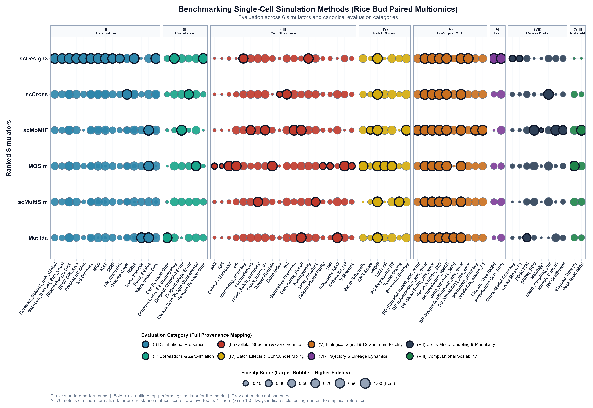

# Plot Multi-Dimensional Benchmarking Bubble Matrix

Produces a multi-dimensional benchmarking bubble matrix comparing
simulation methods. Methods appear as rows; evaluation metrics appear as
columns grouped under the eight canonical evaluation categories (I-VIII)
displayed as colored header strips at the top.

## Usage

``` r
plot_benchmark_bubble_matrix(
  data,
  assay_modality = NULL,
  method_classes = NULL,
  category_colors = NULL,
  metrics_order = NULL,
  methods_order = NULL,
  rank_methods = TRUE,
  compact_strips = TRUE,
  normalize_scores = TRUE,
  show_missing_dots = TRUE,
  bubble_size_range = c(2, 7.8),
  title = NULL,
  subtitle = NULL,
  base_size = 11,
  show_score_labels = FALSE,
  show_category_bars = TRUE
)

plot_bubble_matrix(
  data,
  assay_modality = NULL,
  method_classes = NULL,
  category_colors = NULL,
  metrics_order = NULL,
  methods_order = NULL,
  rank_methods = TRUE,
  compact_strips = TRUE,
  normalize_scores = TRUE,
  show_missing_dots = TRUE,
  bubble_size_range = c(2, 7.8),
  title = NULL,
  subtitle = NULL,
  base_size = 11,
  show_score_labels = FALSE,
  show_category_bars = TRUE
)
```

## Arguments

- data:

  Input data. One of:

  - An `scSimEval_consolidated` object from
    [`evaluate_multiple_datasets()`](https://kabilanbio.github.io/scSimEval/reference/evaluate_multiple_datasets.md).

  - A named list of benchmark outputs from
    [`evaluate_simulation_accuracy()`](https://kabilanbio.github.io/scSimEval/reference/evaluate_simulation_accuracy.md).

  - A tidy `data.frame` with columns: `Method`, `Metric`, `Category`,
    and `Score` (or `Value`).

- assay_modality:

  Optional character scalar ("all", "RNA", or "ATAC") specifying the
  assay modality scope to dynamically format Category V metrics with the
  appropriate differential prefix ("DE/DA ", "DE ", or "DA "). If
  `NULL`, auto-detected from data.

- method_classes:

  Optional named list mapping method names to row group labels.

- category_colors:

  Optional named character vector to override the canonical palette.

- metrics_order:

  Optional character vector for explicit metric ordering (left to
  right).

- methods_order:

  Optional character vector for explicit method ordering (top to
  bottom).

- rank_methods:

  Logical. Automatically rank methods along the vertical axis by mean
  overall fidelity score. Default `TRUE`.

- compact_strips:

  Logical. Use compact two-line facet strip titles for clean horizontal
  layout. Default `TRUE`.

- normalize_scores:

  Logical. Normalize raw distances into \[0, 1\] fidelity scores.
  Default `TRUE`.

- show_missing_dots:

  Logical. Show grey dots for missing metric combinations. Default
  `TRUE`.

- bubble_size_range:

  Numeric vector of length 2: min and max bubble size. Default
  `c(2.0, 7.8)`.

- title:

  Character. Main plot title. If `NULL`, dynamically derived from metric
  count.

- subtitle:

  Character. Plot subtitle.

- base_size:

  Numeric. Base font size. Default `11`.

- show_score_labels:

  Logical. Annotate bubbles with numeric score. Default `FALSE`.

- show_category_bars:

  Logical. Append a compact horizontal summary bar (normalized category
  mean score) at the right end of each category panel. Default `TRUE`.

## Value

A `ggplot` object rendering the multi-dimensional bubble matrix.

## Details



**Bubble encoding:**

- **Size**: Normalized fidelity score \[0, 1\] – larger = better
  performance.

- **Fill color**: Evaluation category (one of the eight canonical
  groups).

- **Circle (standard outline)**: Standard performance for that metric.

- **Bold outline circle (shape 21, stroke 1.6)**: Top-performing
  simulator for that specific metric.

- **Small grey dot**: Metric not available/computed for that method.

**Score normalization** is direction-aware: distance/error metrics are
inverted so that 1 always means best performance, while
concordance/correlation metrics are used directly (higher = better).

## Examples

``` r
bm_df <- data.frame(
  Method = rep(c("scDesign3", "scMultiSim", "Splatter", "SymSim"), each = 6),
  Category = rep(c(
    "(I) Distributional Properties", "(I) Distributional Properties",
    "(II) Sparsity & Zero-Inflation Dynamics",
    "(III) Cellular Manifold & Clustering Concordance",
    "(IV) Technical Variation & Batch Mixing Dynamics",
    "(VIII) Computational Scalability & Efficiency"
  ), 4),
  Metric = rep(c("KS", "Wasserstein", "Zero_Prob_RMSE",
                 "Silhouette_ASW", "CMS", "Core_Seconds"), 4),
  Value = c(
    0.11, 0.18, 0.08, 0.82, 0.86, 42,
    0.15, 0.22, 0.11, 0.78, 0.81, 68,
    0.23, 0.34, 0.17, 0.65, 0.72, 18,
    0.31, 0.45, 0.24, 0.56, 0.64, 95
  ),
  stringsAsFactors = FALSE
)
p <- plot_benchmark_bubble_matrix(bm_df, base_size = 9.5) +
  ggplot2::theme(legend.box = "vertical")
print(p)
```
