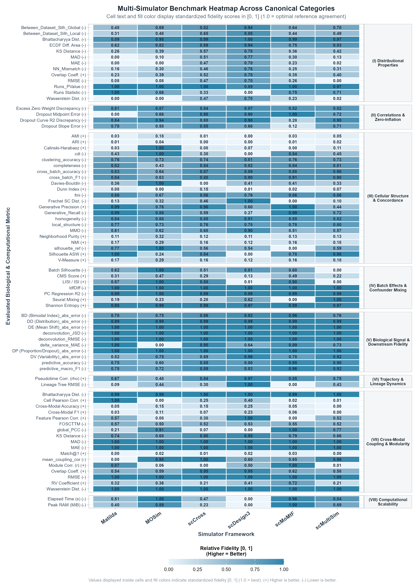

# Plot Multi-Simulator Comparative Metric Heatmap Across Canonical Categories

Produces a 600 DPI comparative heatmap displaying simulators on the
x-axis and evaluated biological/computational measures on the y-axis,
grouped by the 8 canonical evaluation categories. Displays the exact
original raw evaluation score in text inside every cell, with cell fill
colors scaled by relative fidelity (direction-aware, ensuring balanced
visual contrast across all 48 curated evaluation measures without scale
distortion from high-magnitude metrics like RAM or runtime).

## Usage

``` r
plot_metric_heatmap(
  benchmark_data,
  category = NULL,
  metrics = NULL,
  scale_fill = c("relative", "raw"),
  top_n_properties = NULL,
  facet_by_category = TRUE,
  cluster_rows = FALSE,
  cluster_cols = FALSE,
  base_size = 10,
  metric_name = NULL
)
```

## Arguments

- benchmark_data:

  A tidy benchmark summary table or a named list of benchmark tables.

- category:

  Optional character vector to filter by canonical evaluation category.
  Default `NULL` (all 8 categories).

- metrics:

  Optional character vector of specific metrics to include. Default
  `NULL` (all).

- scale_fill:

  Character. Cell color fill scaling: `"relative"` (default;
  direction-aware min-max normalized fidelity in \[0, 1\] across methods
  per metric, ensuring balanced color contrast across all 48 curated
  evaluation measures while cell text displays exact raw numbers) or
  `"raw"` (direct numeric values).

- top_n_properties:

  Optional integer. If specified, restricts to top N most variable
  metrics. Default `NULL` (all metrics).

- facet_by_category:

  Logical. Whether to group rows into vertical category banner panels
  across all 8 categories. Default `TRUE`.

- cluster_rows:

  Logical. Hierarchically cluster measures along y-axis. Default
  `FALSE`.

- cluster_cols:

  Logical. Hierarchically cluster simulators along x-axis. Default
  `FALSE`.

- base_size:

  Numeric. Base font size. Default `10`.

- metric_name:

  Optional legacy alias for `metrics`.

## Value

A `ggplot` object.

## Details



## Examples

``` r
bm_df <- data.frame(
  Method = rep(c("scDesign3", "scMultiSim", "MOSim", "Splatter", "SymSim"), each = 6),
  Category = rep(c(
    "(I) Distributional Properties", "(I) Distributional Properties",
    "(II) Sparsity & Zero-Inflation Dynamics",
    "(III) Cellular Manifold & Clustering Concordance",
    "(IV) Technical Variation & Batch Mixing Dynamics",
    "(V) Biological Signal & Differential Fidelity"
  ), 5),
  Metric = rep(c("KS", "Wasserstein", "Zero_Prob_RMSE", "ARI", "CMS", "DE_F1"), 5),
  Value = c(
    0.10, 0.16, 0.07, 0.85, 0.88, 0.82,
    0.14, 0.21, 0.11, 0.79, 0.83, 0.77,
    0.18, 0.27, 0.13, 0.74, 0.78, 0.72,
    0.23, 0.34, 0.17, 0.67, 0.72, 0.66,
    0.31, 0.44, 0.24, 0.56, 0.62, 0.55
  ),
  stringsAsFactors = FALSE
)
p <- plot_metric_heatmap(bm_df, base_size = 9.5)
print(p)
```
