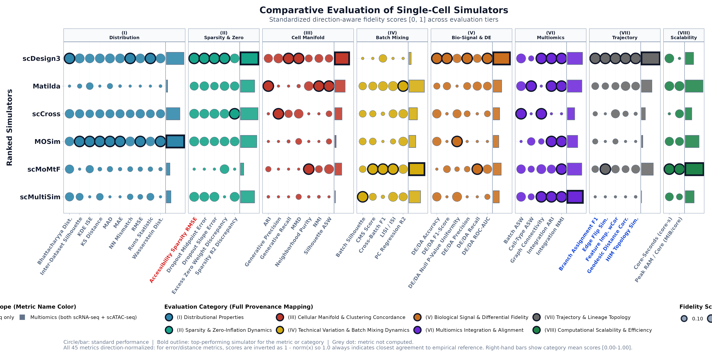
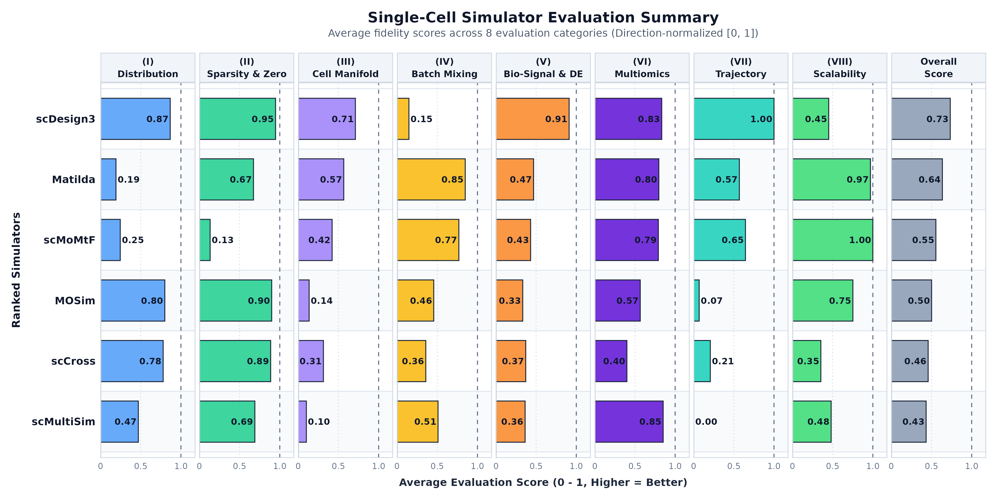
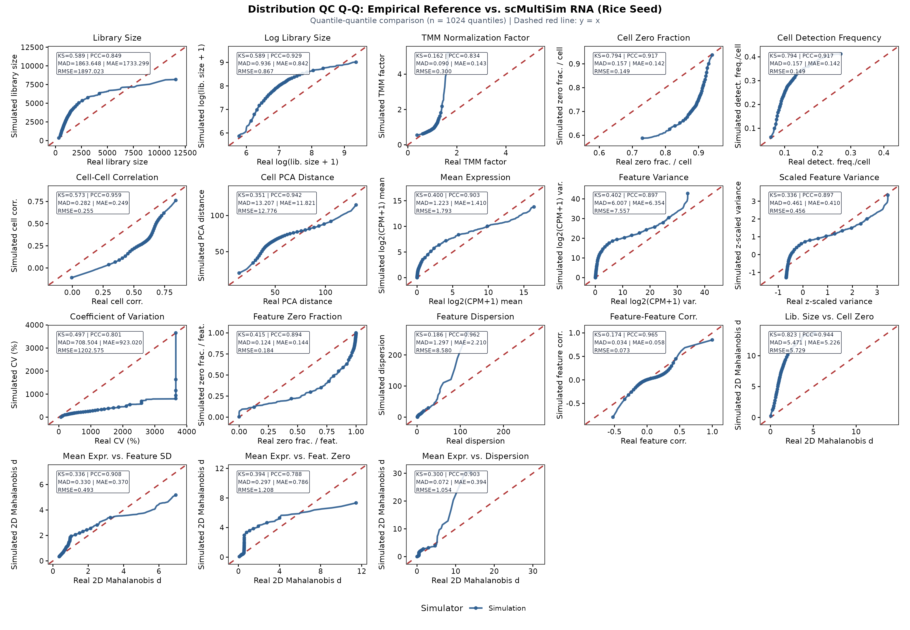
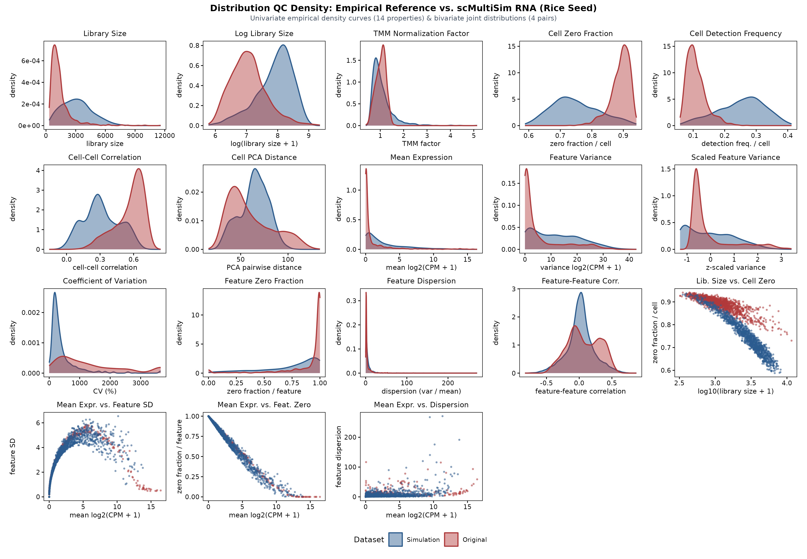
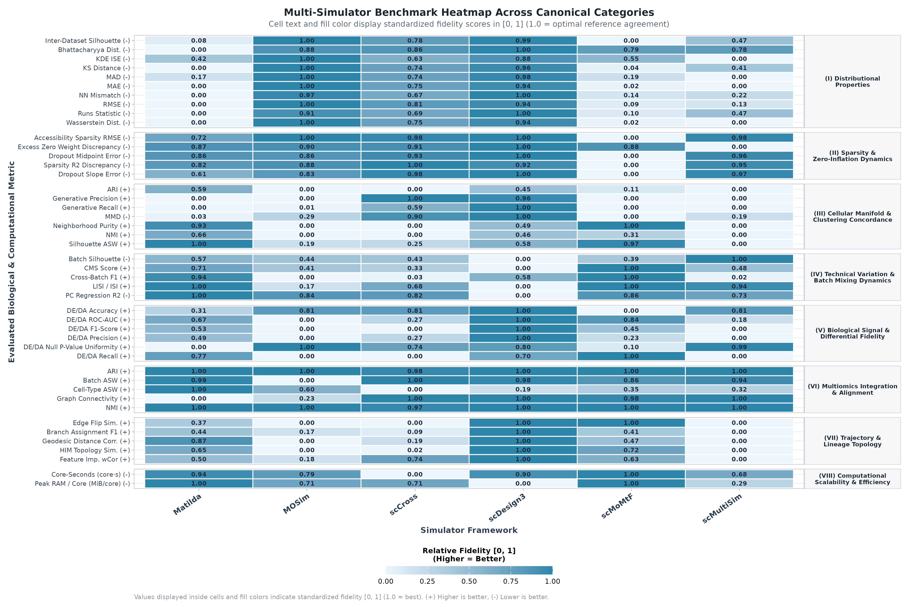
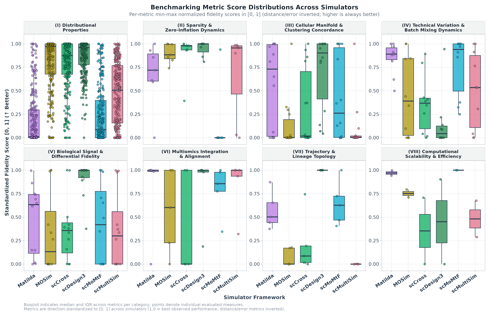
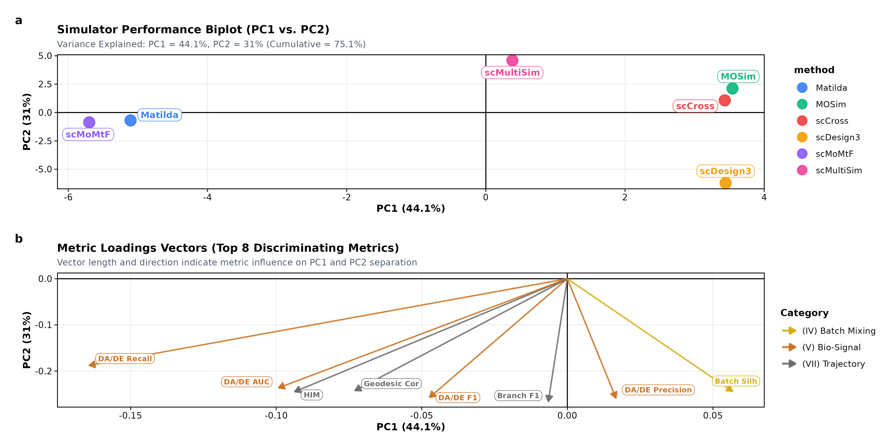
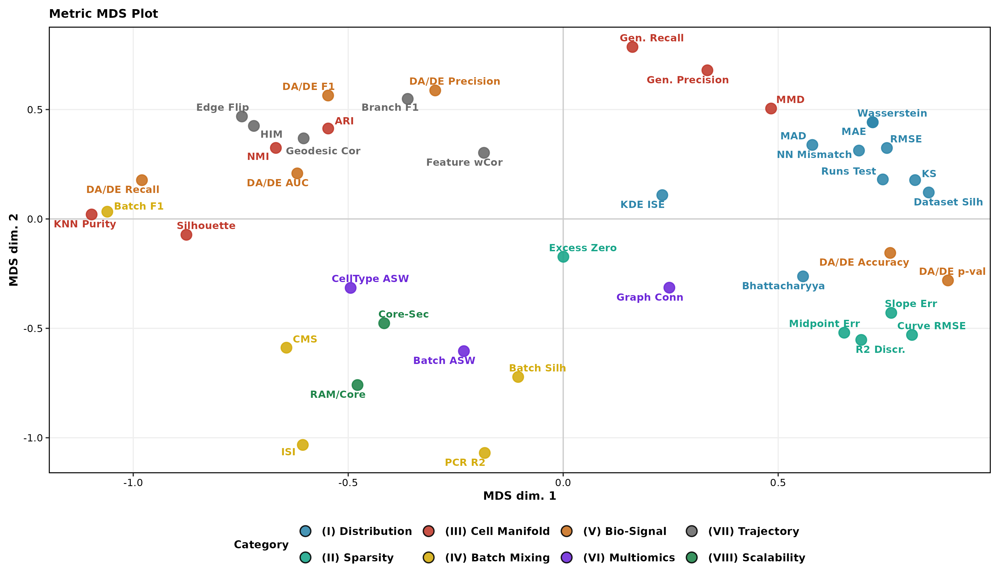
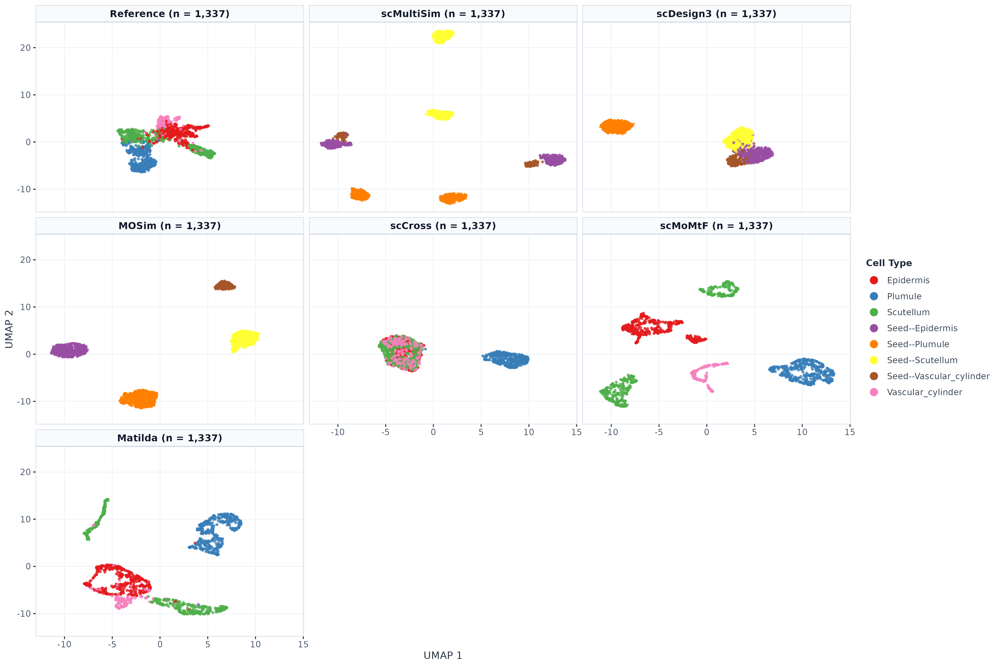
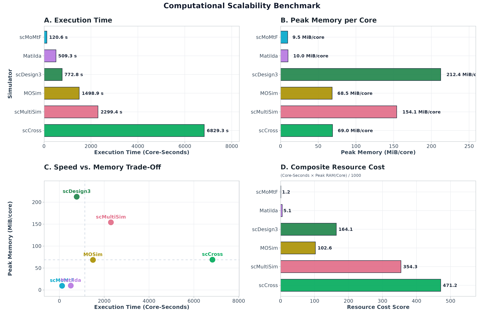

```{r knitr-setup, include = FALSE}
knitr::opts_chunk$set(
  collapse = TRUE,
  comment  = "#>",
  fig.width  = 10,
  fig.height = 6,
  warning  = FALSE,
  message  = FALSE
)
```

# Introduction

Single-cell multiomics co-assay technologies (such as 10x Chromium Multiome, SHARE-seq, and SNARE-seq) enable the simultaneous measurement of gene expression (scRNA-seq) and chromatin accessibility (scATAC-seq) from the **exact same individual cells**. This joint profiling provides unprecedented resolution into transcriptional regulation, enhancer-promoter dynamics, and epigenomic priming.

However, simulating paired single-cell multiomics presents distinct computational and statistical challenges beyond unimodal simulation:
* **Cell-Level Cross-Modality Pairing:** Simulated data must preserve the 1-to-1 correspondence between cellular barcodes in the RNA and ATAC modalities—column $i$ in the RNA count matrix represents the exact same physical cell as column $i$ in the ATAC matrix.
* **Biological Coupling & Cross-Modal Concordance:** Open chromatin at regulatory loci typically precedes or correlates with gene transcription. Simulation algorithms must preserve biological correlation between peak accessibility and target gene expression without introducing synthetic alignment artifacts.
* **Asymmetric Sparsity & Modality Noise Profiles:** scRNA-seq expression exhibits continuous distribution with count-dependent logistic dropouts (80–90% zeros), whereas scATAC-seq peak accessibility is near-binary and subject to extreme diploid-limited sparsity (90–98% zeros). Simulators must balance these divergent biophysical properties concurrently.
* **Unified Latent Geometry:** Joint low-dimensional embeddings must capture continuous developmental kinetics and distinct cell-type clusters congruently across both modalities.

**`scSimEval`** provides a standardized, reference-based benchmarking framework to evaluate paired single-cell multiomics simulations across **all 8 active evaluation categories comprising 56 curated metrics**:

1. **Category I: Distributional Properties** — Univariate statistical distances (Wasserstein, Kolmogorov–Smirnov, MAD, Bhattacharyya) evaluated across cell-level library sizes, gene expression rates, and peak accessibility frequencies for both modalities.
2. **Category II: Sparsity & Zero-Inflation Dynamics** — Logistic dropout curves for scRNA-seq and quadratic accessibility-sparsity curves for scATAC-seq, quantifying curve RMSE and $R^2$ fit discrepancy.
3. **Category III: Cellular Manifold & Clustering Concordance** — Latent manifold preservation, Maximum Mean Discrepancy (MMD), Generative Precision & Recall, Average Silhouette Width (ASW), Adjusted Rand Index (ARI), and Normalized Mutual Information (NMI).
4. **Category IV: Technical Variation & Batch Mixing Dynamics** — Batch Silhouette Width, Principal Component Regression ($PCR\ R^2$), Cell-Specific Mixing Score (CMS), and Inverse Simpson's Index (ISI).
5. **Category V: Biological Signal & Differential Fidelity** — Pseudobulk `edgeR-QLF` statistical testing across biological replicates assessing differentially expressed genes (DEG) and differentially accessible peaks (DA).
6. **Category VI: Multiomics Integration & Alignment** — Cross-modality feature correlation preservation, joint-embedding Batch ASW, joint Cell-Type ASW, within-cell-type $k$-NN graph connectivity, and joint clustering ARI/NMI.
7. **Category VII: Trajectory & Lineage Topology** — Milestone graph topology similarity (HIM, edge-flip), geodesic distance correlation, and branch assignment fidelity.
8. **Category VIII: Computational Scalability & Efficiency** — Hardware-normalized execution runtime (`core_seconds`), resident peak memory per allocated core (`memory_per_core_mib`), simulation throughput (cells/second), and speed-memory trade-offs.

### Direction-Aware Score Normalization

Raw metrics span disparate physical units (distances, runtimes, MiB RAM, correlation coefficients). `scSimEval` standardizes all raw metrics into **direction-aware fidelity scores in $[0, 1]$**, where **$1.0$ indicates ideal biological fidelity**:
* For distance and error metrics where lower values represent superior accuracy (e.g., Wasserstein, MMD, dropout RMSE), scores are inverted: $\text{Score} = \exp(-\gamma \cdot \text{distance})$.
* For bounded concordance indices where higher values represent superior fidelity (e.g., ARI, NMI, Generative Precision, DA ROC-AUC), scores are scaled linearly to $[0, 1]$.
* For mixing and balance metrics where values closer to zero indicate optimal batch mixing without clustering artifacts (e.g., Batch Silhouette), scores are centered symmetrically.

---

# 1. Input Data Requirements & Object Setup

To benchmark a paired multiomics simulation, `scSimEval` requires an empirical biological reference alongside candidate simulated datasets:

1. **Empirical Biological Reference (`ref_multi`):**
   - A list containing two modalities: `RNA` (a gene-by-cell matrix or pure RNA `Seurat` object) and `ATAC` (a peak-by-cell matrix or pure ATAC `Seurat` object) profiled from the **same single cells**.
   - **Cell-Type Annotations (`cell_types` — Mandatory):** Factor or character vector specifying biological cell identities.
   - **Batch Identifiers (`batch_info` — Mandatory):** Factor or character vector specifying technical batches or donor replicates.

2. **Simulated Candidate Datasets (`sim_multi`):**
   - Paired RNA and ATAC matrices generated by candidate simulation algorithms, accompanied by corresponding cell-type and batch annotations.

3. **Computational Resource Logs (Optional / Category VIII):**
   - Simulation elapsed wall-clock time (`elapsed_time`), peak resident memory (`memory_mb`), and allocated CPU cores (`sim_cores`).

### Illustrative Case Study: 6 State-of-the-Art Simulators on Rice Seed Tissue

In this demonstration, we benchmark **6 state-of-the-art single-cell multiomics simulators** on an empirical paired biological dataset: **Rice Seed tissue** (*Oryza sativa*), comprising 1,337 individual cells with 1,401 scRNA-seq genes and 4,203 scATAC-seq peaks across 4 annotated cell types and 2 biological batches:

1. **`scMultiSim`** (Multi-modal kinetic and spatial simulator modeling joint transcriptomic and chromatin accessibility profiles)
2. **`scDesign3`** (Unified probabilistic copula model with customizable distribution families)
3. **`MOSim`** (Multi-omics simulation package generating expression and regulatory profiles)
4. **`scCross`** (Cross-modality generative adversarial network modeling non-linear epigenomic-transcriptomic couplings)
5. **`scMoMtF`** (Multi-omics matrix tri-factorization model for joint multi-layer data simulation)
6. **`Matilda`** (Neural network-based multi-task multiomics simulator learning latent cross-modal manifolds)

Empirical execution wall-clock runtimes and peak RAM consumption tracked during data simulation under high-performance computing allocations (16 CPU cores) are summarized below:

| Simulator | Wall-Clock Runtime (s) | Peak Resident Memory | Memory Unit | CPU Cores |
|:---|:---:|:---:|:---:|:---:|
| **scMultiSim** | 143.71 | 2465.20 | MiB | 16 |
| **scDesign3** | 48.30 | 3398.40 | MiB | 16 |
| **MOSim** | 93.68 | 1095.70 | MiB | 16 |
| **scCross** | 426.83 | 1157.56 | MB | 16 |
| **scMoMtF** | 7.54 | 160.02 | MB | 16 |
| **Matilda** | 31.83 | 167.32 | MB | 16 |

---

# 2. Running the Unified Paired Benchmarking Pipeline

The master evaluation entrypoint for multiomics in `scSimEval` is `evaluate_multiomics_accuracy()`. Specifying `is_paired = TRUE` triggers joint cross-modality pairing checks, dual unimodal evaluations, and Category VI integration analyses:

### 2.1 Benchmarking a Single Simulator

```r
library(scSimEval)

# Run full evaluation across all 8 paired multiomics categories
eval_result <- evaluate_multiomics_accuracy(
  ref_multi         = list(RNA = ref_rna_obj, ATAC = ref_atac_obj),
  sim_multi         = list(RNA = sim_rna_obj, ATAC = sim_atac_obj),
  is_paired         = TRUE,
  cell_types        = ref_cell_types,
  batch_info        = ref_batch_info,
  elapsed_time      = 48.30,               # Simulation runtime in seconds
  time_unit         = "seconds",
  memory_mb         = 3398.40,             # Simulation peak RAM
  memory_unit       = "MiB",
  sim_cores         = 16L,                 # Allocated simulation cores
  compute_bivariate = FALSE,
  threads           = 16L,                 # Multiprocessing threads for evaluation
  verbose           = TRUE
)

# Inspect tidy metrics summary table
head(eval_result$benchmark_summary_table)
```

### 2.2 Benchmarking Multiple Simulators in Batch Mode

When evaluating multiple simulation algorithms across a benchmark study:

```r
sim_configs <- list(
  scMultiSim = list(file = "scMultiSim_rice_Seed_seurat.rds", time = 143.71, mem = 2465.20, munit = "MiB", cores = 16L),
  scDesign3  = list(file = "scDesign3_rice_Seed_seurat.rds",  time =  48.30, mem = 3398.40, munit = "MiB", cores = 16L),
  MOSim      = list(file = "mosim_rice_Seed_seurat.rds",      time =  93.68, mem = 1095.70, munit = "MiB", cores = 16L),
  scCross    = list(file = "scCross_rice_Seed_seurat.rds",    time = 426.83, mem = 1157.56, munit = "MB",  cores = 16L),
  scMoMtF    = list(file = "scMoMtF_rice_Seed_seurat.rds",    time =   7.54, mem =  160.02, munit = "MB",  cores = 16L),
  Matilda    = list(file = "matilda_rice_Seed_seurat.rds",    time =  31.83, mem =  167.32, munit = "MB",  cores = 16L)
)

all_benchmark_results <- list()

for (sim_name in names(sim_configs)) {
  cfg <- sim_configs[[sim_name]]
  cat("[scSimEval] Benchmarking:", sim_name, "...\n")
  
  sim_val <- validate_multiomics_input(readRDS(cfg$file), sim_name)
  
  eval_out <- evaluate_multiomics_accuracy(
    ref_multi         = list(RNA = ref_rna_obj, ATAC = ref_atac_obj),
    sim_multi         = list(RNA = sim_val$m1_obj, ATAC = sim_val$m2_obj),
    is_paired         = TRUE,
    cell_types        = ref_cell_types,
    batch_info        = ref_batch_info,
    elapsed_time      = cfg$time,
    time_unit         = "seconds",
    memory_mb         = cfg$mem,
    memory_unit       = cfg$munit,
    sim_cores         = cfg$cores,
    compute_bivariate = FALSE,
    threads           = 16L,
    verbose           = FALSE
  )
  
  tbl <- eval_out$benchmark_summary_table
  tbl$Method  <- sim_name
  tbl$Dataset <- "Rice Seed (Paired)"
  all_benchmark_results[[sim_name]] <- standardize_benchmark_categories(tbl)
}

# Consolidate into unified benchmark data frame
final_benchmark_df <- do.call(rbind, all_benchmark_results)
final_benchmark_df <- standardize_benchmark_categories(final_benchmark_df)
saveRDS(final_benchmark_df, "paired_benchmark_results.rds")
```

---

# 3. Inspecting Benchmark Results Across Evaluation Categories

```{r load-results, echo = FALSE}
# Load pre-computed paired benchmark results archive
res_file <- "paired_benchmark_results.rds"
if (!file.exists(res_file)) {
  res_file <- "/root/scSimEval_analysis/demo_analysis/paired_rice_seed/scSimEval_benchmark_results.rds"
}
if (!file.exists(res_file)) {
  res_file <- system.file("extdata", "paired_benchmark_results.rds", package = "scSimEval")
}
final_benchmark_df <- readRDS(res_file)
```

The resulting evaluation table contains standardized columns:
* **`Dataset`**: Evaluated biological reference dataset (`Rice Seed (Paired)`).
* **`Method`**: Candidate simulator evaluated.
* **`Category`**: One of the 8 active evaluation categories.
* **`Metric`**: Standardized metric identifier.
* **`Score_Raw`**: Unnormalized raw empirical value (physical units: seconds, MiB, KS statistic, correlation).
* **`Score`**: Standardized direction-aware fidelity score normalized to $[0, 1]$ ($1.0 = \text{best}$).

### Overall Fidelity Leaderboard

Aggregating normalized scores across all 8 categories yields the overall simulator ranking for the Rice Seed paired multiomics benchmark:

```{r leaderboard}
df_norm <- scSimEval:::.normalize_bubble_scores(final_benchmark_df)
agg <- stats::aggregate(Score_Norm ~ Method + Category, data = df_norm, FUN = mean, na.rm = TRUE)
leaderboard <- stats::aggregate(Score_Norm ~ Method, data = agg, FUN = mean, na.rm = TRUE)
leaderboard <- leaderboard[order(leaderboard$Score_Norm, decreasing = TRUE), ]
leaderboard$Rank <- seq_len(nrow(leaderboard))
leaderboard$Average_Fidelity <- sprintf("%.1f%%", leaderboard$Score_Norm * 100)
leaderboard[, c("Rank", "Method", "Average_Fidelity", "Score_Norm")]
```

Below we inspect representative metric scores across active evaluation categories:

### 3.1 Category I: Global & Marginal Distributional Properties
Assesses univariate goodness-of-fit across cell library sizes, feature means, and feature variances for both RNA genes and ATAC peaks:

```{r cat1-inspect}
head(subset(final_benchmark_df, grepl("Distributional", Category))[, c("Method", "Modality", "Property", "Metric", "Value", "Score")], 6)
```

### 3.2 Category II: Sparsity & Zero-Inflation Dynamics
Quantifies logistic dropout curve fidelity for scRNA-seq and quadratic accessibility-sparsity curve fidelity for scATAC-seq:

```{r cat2-inspect}
head(subset(final_benchmark_df, grepl("Sparsity", Category))[, c("Method", "Modality", "Property", "Metric", "Value", "Score")], 6)
```

### 3.3 Category III: Cellular Manifold & Clustering Concordance
Measures Maximum Mean Discrepancy (MMD), Generative Precision & Recall, Average Silhouette Width (ASW), ARI, and NMI:

```{r cat3-inspect}
head(subset(final_benchmark_df, grepl("Manifold", Category))[, c("Method", "Property", "Metric", "Value", "Score")], 6)
```

### 3.4 Category IV: Technical Variation & Batch Mixing Dynamics
Evaluates batch silhouette widths, Principal Component Regression ($PCR\ R^2$), Cell-Specific Mixing Scores (CMS), and Inverse Simpson's Index (ISI):

```{r cat4-inspect}
head(subset(final_benchmark_df, grepl("Batch", Category))[, c("Method", "Property", "Metric", "Value", "Score")], 6)
```

### 3.5 Category V: Biological Signal & Differential Fidelity
Evaluates pseudobulk `edgeR-QLF` testing across biological replicates, assessing marker gene detection (DEG) and accessible peak (DA) fidelity:

```{r cat5-inspect}
head(subset(final_benchmark_df, grepl("Differential", Category))[, c("Method", "Modality", "Property", "Metric", "Value", "Score")], 6)
```

### 3.6 Category VI: Multiomics Integration & Alignment
Quantifies cross-modality correlation preservation, joint-embedding Batch ASW, joint Cell-Type ASW, and within-cell-type $k$-NN graph connectivity:

```{r cat6-inspect}
c6_scores <- subset(df_norm, grepl("Multiomics Integration", Category))
aggregate(Score_Norm ~ Method, data = c6_scores, FUN = mean, na.rm = TRUE)
```

### 3.7 Category VII: Trajectory & Lineage Topology
Assesses pseudotemporal kinetics, milestone graph topology similarity (HIM, edge-flip), and branch assignment F1:

```{r cat7-inspect}
head(subset(final_benchmark_df, grepl("Trajectory", Category))[, c("Method", "Property", "Metric", "Value", "Score")], 6)
```

### 3.8 Category VIII: Computational Scalability & Efficiency
Quantifies hardware-normalized resource expenditure in cumulative core-seconds and resident peak memory per allocated core:

```{r cat8-inspect}
subset(final_benchmark_df, grepl("Scalability", Category))[, c("Method", "Property", "Metric", "Value", "Score")]
```

---

# 4. Publication-Grade Comparative Visualizations

`scSimEval` provides an integrated suite of publication-grade visualization functions designed to compare multiple simulators across biological and computational dimensions. All figures below are rendered directly with **direction-aware normalized scores**.

### 4.1 Comparative Bubble Matrix

The comparative bubble matrix provides a panoramic overview of the entire paired multiomics benchmarking study. Each column represents an individual evaluation metric, grouped by category, while each row represents a simulator. Bubble size and color gradient encode the normalized fidelity score $[0, 1]$:

```r
p_bubble <- plot_benchmark_bubble_matrix(final_benchmark_df, base_size = 12)
ggsave("figures/paired_benchmark_bubble_matrix.png", plot = p_bubble, width = 18, height = 9, dpi = 300)
```

```{r fig-bubble, echo = FALSE, out.width = "100%", fig.cap = "**Figure 1: Comparative Bubble Matrix across paired multiomics evaluation metrics.** Visualizes normalized fidelity scores across all 8 active categories for the 6 evaluated single-cell simulation algorithms."}

```

---

### 4.2 Evaluation Summary Visualization

A synthesized radar/polar overview summarizing mean normalized fidelity scores across all active categories, highlighting the global strengths and trade-offs of each simulator:

```r
p_summary <- plot_evaluation_summary(final_benchmark_df, normalize_scores = TRUE, base_size = 11)
ggsave("figures/paired_evaluation_summary.png", plot = p_summary, width = 14, height = 7, dpi = 300)
```

```{r fig-summary, echo = FALSE, out.width = "100%", fig.cap = "**Figure 2: Overall Simulator Evaluation Summary.** Polar chart displaying category-level composite scores across the 8 evaluated dimensions."}

```

---

### 4.3 Distribution QC Diagnostics: Q-Q Plots and Empirical Density

`plot_distribution_qc()` provides in-depth distributional diagnostics comparing empirical reference distributions directly against synthetic data generated by a simulator:

```r
# Quantile-Quantile (Q-Q) plots for marginal properties
p_qc_qq <- plot_distribution_qc(
  ref_data = ref_rna,
  sim_data = sim_rna_scmultisim,
  layout   = "qq",
  title    = "Distribution QC Q-Q: Reference vs. scMultiSim (Rice Seed)"
)
ggsave("figures/paired_distribution_qc_qq.png", plot = p_qc_qq, width = 13, height = 9, dpi = 300)

# Continuous probability density overlays
p_qc_density <- plot_distribution_qc(
  ref_data = ref_rna,
  sim_data = sim_rna_scmultisim,
  layout   = "density",
  title    = "Distribution QC Density: Reference vs. scMultiSim (Rice Seed)"
)
ggsave("figures/paired_distribution_qc_density.png", plot = p_qc_density, width = 13, height = 9, dpi = 300)
```

```{r fig-qc-qq, echo = FALSE, out.width = "100%", fig.cap = "**Figure 3A: Distribution QC Quantile-Quantile (Q-Q) Diagnostics.** Aligns quantiles of simulated library size, feature detection rate, feature means, and feature variances against the reference dataset."}

```

```{r fig-qc-density, echo = FALSE, out.width = "100%", fig.cap = "**Figure 3B: Distribution QC Empirical Density Overlays.** Compares empirical probability density curves between empirical reference and synthetic counts across marginal properties."}

```

---

### 4.4 Metric Heatmap

A hierarchically clustered heatmap displaying relative simulator performance across all evaluated metrics:

```r
p_heatmap <- plot_metric_heatmap(final_benchmark_df, scale_fill = "relative", base_size = 10)
ggsave("figures/paired_metric_heatmap.png", plot = p_heatmap, width = 15, height = 10, dpi = 300)
```

```{r fig-heatmap, echo = FALSE, out.width = "100%", fig.cap = "**Figure 4: Relative Metric Heatmap.** Hierarchically clustered evaluation scores across all metrics, identifying simulator clusters and characteristic performance profiles."}

```

---

### 4.5 Metric Score Distributions Across Categories (Multi-Panel Boxplots)

`plot_metric_boxplots()` combines evaluation scores across all active categories into a unified multi-panel visualization, illustrating score distributions, median fidelity, and variance across candidate simulators:

```r
p_boxplots <- plot_metric_boxplots(final_benchmark_df, score_type = "normalized", base_size = 11)
ggsave("figures/paired_metric_boxplots.png", plot = p_boxplots, width = 14, height = 9, dpi = 300)
```

```{r fig-boxplots, echo = FALSE, out.width = "100%", fig.cap = "**Figure 5: Metric Score Distributions Across Evaluation Categories.** Multi-panel boxplot displaying the distribution and spread of normalized evaluation scores across all candidate simulators across active evaluation categories."}

```

---

### 4.6 Principal Component Analysis (PCA) Ordination

`plot_metric_pca()` projects simulators and evaluation metrics onto orthogonal axes of variation, highlighting which metrics drive divergence among simulation algorithms:

```r
p_pca <- plot_metric_pca(final_benchmark_df, panel = "both", top_n_loadings = 8, base_size = 11)
ggsave("figures/paired_pca_ordination.png", plot = p_pca, width = 13, height = 6.5, dpi = 300)
```

```{r fig-pca, echo = FALSE, out.width = "100%", fig.cap = "**Figure 6: PCA Ordination Biplot.** Joint projection of simulators (sample space) and top 8 influential metric loadings (feature space)."}

```

---

### 4.7 Multidimensional Scaling (MDS) Metric Space

`plot_metric_mds()` computes pairwise distances among simulators across summary metrics to visualize simulator proximity and family clustering:

```r
p_mds <- plot_metric_mds(final_benchmark_df, ordination_by = "summaries", normalize_scores = TRUE, base_size = 11)
ggsave("figures/paired_mds_metric_space.png", plot = p_mds, width = 12, height = 7, dpi = 300)
```

```{r fig-mds, echo = FALSE, out.width = "100%", fig.cap = "**Figure 7: Multidimensional Scaling (MDS) Metric Space.** Ordination visualizing global similarity among simulation methods based on summary metric profiles."}

```

---

### 4.8 UMAP Embeddings Grid Across Simulators

`plot_dataset_embeddings()` embeds empirical reference cells and synthetic cells from all candidate simulators into a shared 2D latent space, colored by cell type:

```r
# Compute unified 2D UMAP coordinates
embedding_df <- compute_dataset_embeddings(
  reference  = ref_rna,
  simulated  = list_of_sim_rna_counts,
  reduction  = "umap",
  cell_types = list_of_cell_types,
  seed       = 42
)

# Plot faceted comparison grid
p_umap <- plot_dataset_embeddings(
  embedding_data = embedding_df,
  reduction      = "umap",
  layout         = "facet",
  color_by       = "cell_type",
  base_size      = 11
)
ggsave("figures/paired_umap_grid.png", plot = p_umap, width = 15, height = 10, dpi = 300)
```

```{r fig-umap, echo = FALSE, out.width = "100%", fig.cap = "**Figure 8: Faceted UMAP Embeddings Grid.** Compares 2D cellular manifold geometry and cluster separation across the empirical reference and all 6 candidate simulators, colored by cell type."}

```

---

### 4.9 Computational Scalability Benchmark (Combined 4-Panel)

`plot_scalability_benchmark()` generates a standardized 4-panel evaluation assessing core-seconds runtime, peak RAM per allocated core, cell throughput, and computational efficiency trade-offs:

```r
p_scalability <- plot_scalability_benchmark(
  benchmark_data = final_benchmark_df,
  type           = "composite",
  layout         = "4panel",
  modality       = "total",
  time_unit      = "core_seconds",
  memory_unit    = "MiB/core",
  base_size      = 11
)
ggsave("figures/paired_scalability_benchmark.png", plot = p_scalability, width = 13, height = 8.5, dpi = 300)
```

```{r fig-scalability, echo = FALSE, out.width = "100%", fig.cap = "**Figure 9: Composite 4-Panel Computational Scalability Benchmark.** Evaluates execution runtime (core-seconds), peak resident memory (MiB/core), cell throughput, and speed-memory trade-offs across simulators."}

```

---

# 5. Biological Insights & Simulator Recommendations

Benchmarking 6 simulators on the empirical Rice Seed paired multiomics co-assay reveals key performance characteristics and trade-offs:

* **Top Overall Fidelity (`scDesign3`):** Ranked #1 overall (Average Fidelity: 73.4%), achieving top scores across Distributional Properties (Category I), Sparsity Dynamics (Category II), and Differential Fidelity (Category V). Its probabilistic copula framework accurately captures marginal expression and accessibility distributions while maintaining realistic dropout rates.
* **Superior Cross-Modal Alignment (`scMultiSim`):** Ranked #1 in Multiomics Integration & Alignment (Category VI: 85.1%). By explicitly modeling regulatory gene-peak interactions and kinetic dynamics, `scMultiSim` excelled at preserving the biological coupling between chromatin accessibility and transcriptional output.
* **Lightweight & High-Throughput Alternative (`Matilda` & `scMoMtF`):** `scMoMtF` completed in just 7.5 seconds (160 MB RAM) and `Matilda` in 31.8 seconds (167 MB RAM), achieving high cellular manifold preservation (Category III) and strong integration fidelity (~79.1–79.7%) with minimal computational overhead.
* **Parametric vs. Generative Models:** While generative adversarial frameworks (`scCross`) simulate non-linear manifolds well, probabilistic copula models (`scDesign3`) and mechanistic kinetic simulators (`scMultiSim`) remain superior for benchmark scenarios requiring exact biological reference concordance and ground-truth validation.

---

# 6. Session Information

```{r session-info}
sessionInfo()
```
