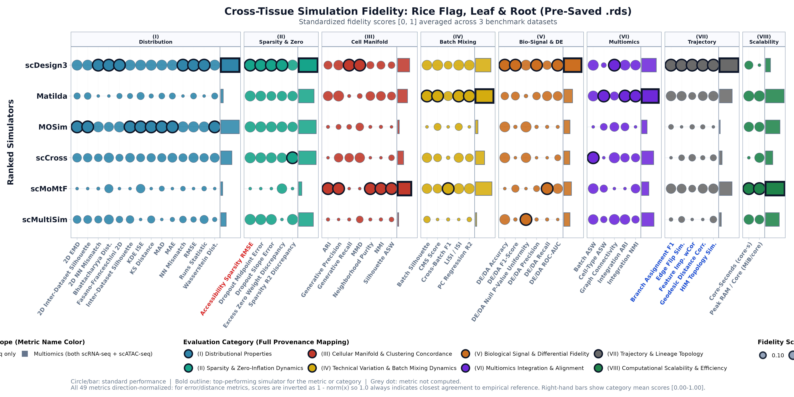
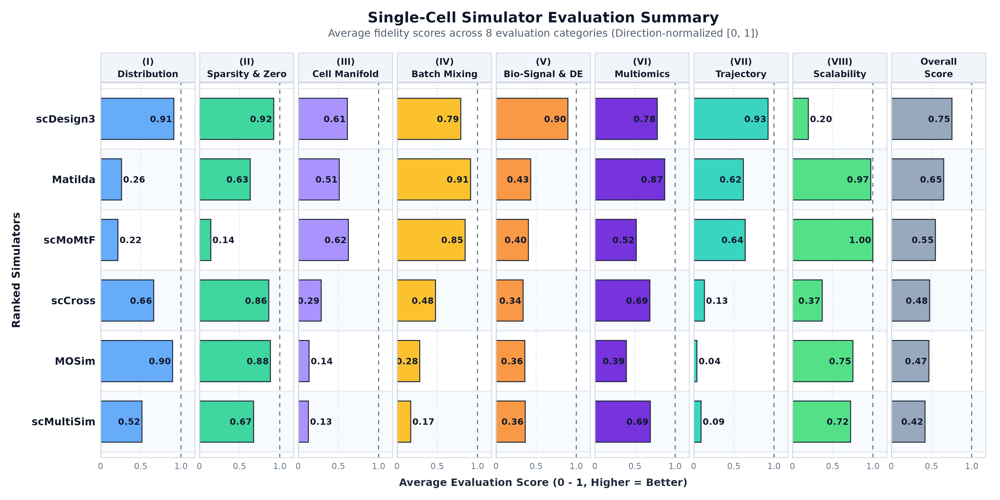
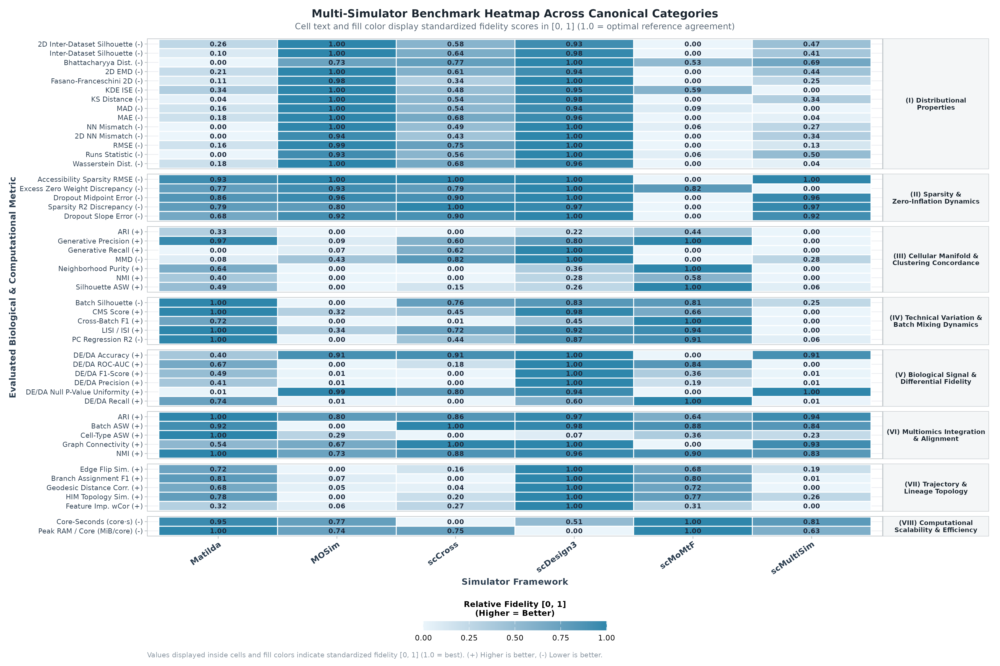
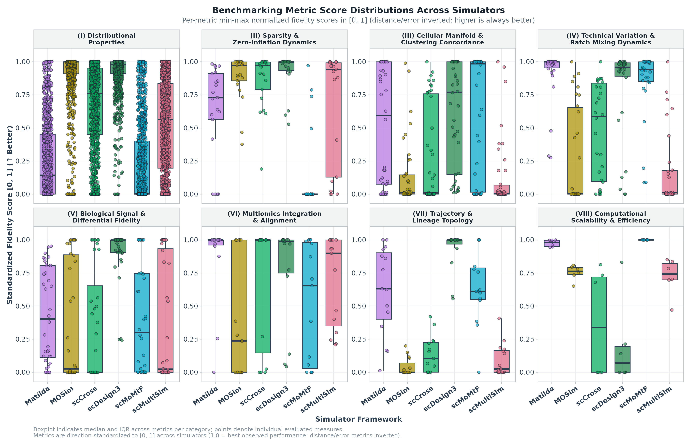
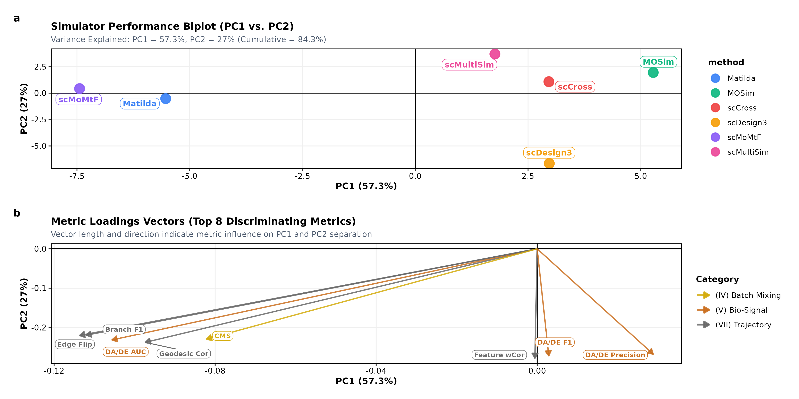
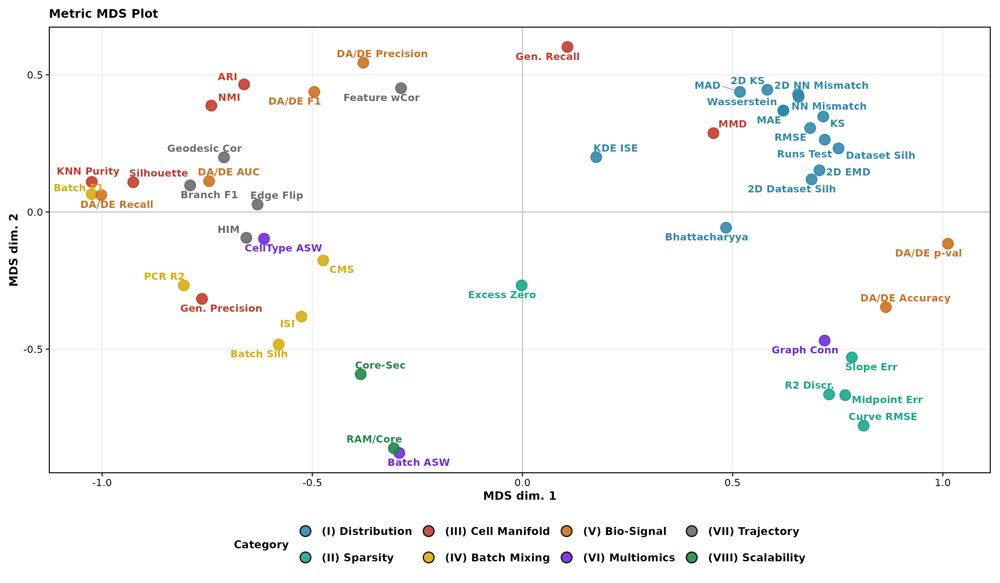
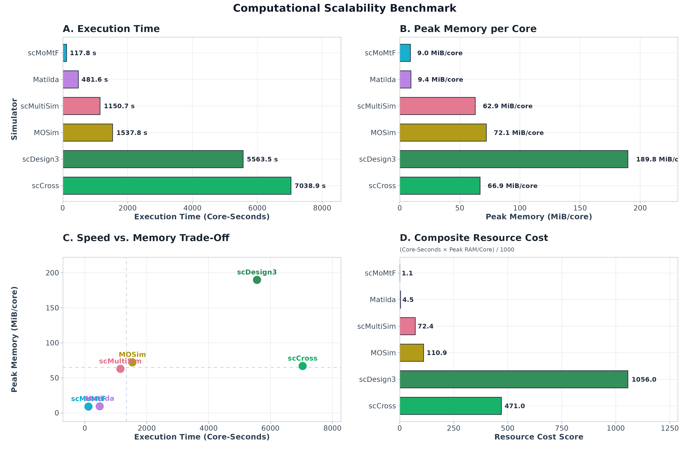

```{r knitr-setup, include = FALSE}
knitr::opts_chunk$set(
  collapse = TRUE,
  comment  = "#>",
  fig.width  = 10,
  fig.height = 6,
  warning  = FALSE,
  message  = FALSE
)
```

# Introduction

In multi-tissue or multi-simulator benchmarking studies executed on high-performance computing (HPC) clusters, computing the full 56-metric evaluation suite across dozens of dataset-simulator pairs is computationally intensive. Once evaluations are serialized to `.rds` files via `saveRDS()`, **`scSimEval`** enables instant reloading, cross-dataset consolidation, custom leaderboard ranking, and publication-grade visualization — **without re-computing a single metric**.

This demonstration illustrates a complete downstream `.rds` workflow using **3 independently saved Rice paired multiomics benchmark sessions** (`Flag`, `Leaf`, and `Root` tissues), each containing all 6 simulators (`scDesign3`, `MOSim`, `scCross`, `scMultiSim`, `Matilda`, and `scMoMtF`) evaluated across all 8 canonical categories (2,142 metric evaluations per tissue; 6,426 total rows).

---

# 1. Loading & Merging Multiple Pre-Saved `.rds` Sessions

Each saved session `.rds` archive contains the standardized `benchmark_df`, dataset summaries, and metadata. Using `combine_benchmark_results()`, multiple `.rds` files computed on separate nodes or at different times can be merged into a unified cross-tissue benchmark table in seconds:

```r
library(scSimEval)

# 1. Load three independently saved benchmark sessions (zero re-computation)
flag_sess <- readRDS("rice_Flag_vs_all_6_simulators.rds")
leaf_sess <- readRDS("rice_Leaf_vs_all_6_simulators.rds")
root_sess <- readRDS("rice_Root_vs_all_6_simulators.rds")

# 2. Extract their tidy benchmark tables
raw_dfs <- list(
  Flag = flag_sess$benchmark_df,
  Leaf = leaf_sess$benchmark_df,
  Root = root_sess$benchmark_df
)

# 3. Consolidate into a single cross-tissue benchmark with re-normalized scores
combined_res <- combine_benchmark_results(
  list_of_benchmarks   = raw_dfs,
  filter_gold_standard = TRUE,
  recompute_normalized = TRUE
)

combined_df <- standardize_benchmark_categories(combined_res$granular_benchmark_table)
saveRDS(combined_df, "scSimEval_combined_benchmark_results.rds")
```

```{r load-combined, echo = FALSE}
library(scSimEval)
res_file <- "presaved_benchmark_results.rds"
if (!file.exists(res_file)) {
  res_file <- "/root/scSimEval_analysis/demo_analysis/pre_saved_rds_analysis/scSimEval_combined_benchmark_results.rds"
}
combined_df <- readRDS(res_file)
```

Let's inspect the consolidated cross-tissue object structure:

```{r inspect-combined}
cat("Total consolidated metric rows:", nrow(combined_df), "\n")
cat("Datasets merged:", paste(unique(combined_df$Dataset), collapse = ", "), "\n")
cat("Simulators evaluated:", paste(unique(combined_df$Method), collapse = ", "), "\n\n")
head(combined_df[, c("Dataset", "Method", "Category", "Metric", "Score_Raw", "Score")], 8)
```

---

# 2. Computing Cross-Tissue, Per-Tissue & Category Leaderboards

### 2.1 Overall Cross-Tissue Composite Leaderboard (Flag + Leaf + Root)

`compute_method_leaderboard()` aggregates direction-aware normalized fidelity scores across all three tissues and all 8 categories:

```{r overall-leaderboard}
overall_lb <- compute_method_leaderboard(combined_df)
print(overall_lb)
```

### 2.2 Per-Tissue Consistency Check

Evaluating each tissue individually confirms whether simulator rankings remain stable across distinct plant organs:

```{r per-tissue-leaderboard}
per_tissue_lbs <- lapply(unique(combined_df$Dataset), function(ds) {
  lb <- compute_method_leaderboard(subset(combined_df, Dataset == ds))
  lb$Dataset <- ds
  lb[, c("Dataset", "Overall_Rank", "Method", "Average_Fidelity", "Fidelity_Score")]
})
do.call(rbind, per_tissue_lbs)
```

### 2.3 Category-Specific Leaderboards

Researchers can slice the pre-saved `.rds` table to rank simulators within specific biological domains — for example, **Category I (Distributional Properties)** and **Category VI (Multiomics Integration & Alignment)**:

```{r category-leaderboards}
# Category I: Distributional Properties
cat1_lb <- compute_method_leaderboard(
  subset(combined_df, Category == "(I) Distributional Properties")
)
print(cat1_lb)

# Category VI: Multiomics Integration & Alignment
cat6_lb <- compute_method_leaderboard(
  subset(combined_df, Category == "(VI) Multiomics Integration & Alignment")
)
print(cat6_lb)
```

---

# 3. Publication-Grade Cross-Tissue Visualizations from `.rds`

Every visualization function in `scSimEval` accepts the consolidated `.rds` data frame directly, enabling rapid regeneration of high-resolution manuscript figures.

### 3.1 Cross-Tissue Comparative Bubble Matrix

```r
p_bubble <- plot_benchmark_bubble_matrix(
  combined_df,
  title     = "Cross-Tissue Simulation Fidelity: Rice Flag, Leaf & Root (Pre-Saved .rds)",
  base_size = 12
)
ggsave("figures/presaved_benchmark_bubble_matrix.png", plot = p_bubble, width = 18, height = 9, dpi = 300)
```

```{r fig-bubble, echo = FALSE, out.width = "100%", fig.cap = "**Figure 1: Cross-Tissue Comparative Bubble Matrix (Rice Flag, Leaf & Root).** Consolidates normalized fidelity scores across all 8 evaluation categories and 6 simulators directly from three pre-saved `.rds` session archives."}

```

---

### 3.2 Evaluation Summary Polar Chart

```r
p_summary <- plot_evaluation_summary(combined_df, normalize_scores = TRUE, base_size = 11)
ggsave("figures/presaved_evaluation_summary.png", plot = p_summary, width = 14, height = 7, dpi = 300)
```

```{r fig-summary, echo = FALSE, out.width = "100%", fig.cap = "**Figure 2: Cross-Tissue Evaluation Summary Polar Chart.** Displays aggregated category-level fidelity scores across Rice Flag, Leaf, and Root tissues."}

```

---

### 3.3 Relative Metric Heatmap

```r
p_heatmap <- plot_metric_heatmap(combined_df, scale_fill = "relative", base_size = 10)
ggsave("figures/presaved_metric_heatmap.png", plot = p_heatmap, width = 15, height = 10, dpi = 300)
```

```{r fig-heatmap, echo = FALSE, out.width = "100%", fig.cap = "**Figure 3: Cross-Tissue Relative Metric Heatmap.** Hierarchically clustered relative fidelity scores aggregated across Flag, Leaf, and Root paired multiomics benchmarks."}

```

---

### 3.4 Multi-Panel Category Boxplots

```r
p_boxplots <- plot_metric_boxplots(combined_df, score_type = "normalized", base_size = 11)
ggsave("figures/presaved_metric_boxplots.png", plot = p_boxplots, width = 14, height = 9, dpi = 300)
```

```{r fig-boxplots, echo = FALSE, out.width = "100%", fig.cap = "**Figure 4: Cross-Tissue Metric Score Distributions Across Categories.** Captures inter-tissue and inter-metric score variance across all 8 categories."}

```

---

### 3.5 PCA Ordination Biplot & MDS Metric Space

```r
p_pca <- plot_metric_pca(combined_df, panel = "both", top_n_loadings = 8, base_size = 11)
ggsave("figures/presaved_pca_ordination.png", plot = p_pca, width = 13, height = 6.5, dpi = 300)

p_mds <- plot_metric_mds(combined_df, ordination_by = "summaries", normalize_scores = TRUE, base_size = 11)
ggsave("figures/presaved_mds_metric_space.png", plot = p_mds, width = 12, height = 7, dpi = 300)
```

```{r fig-pca, echo = FALSE, out.width = "100%", fig.cap = "**Figure 5: Cross-Tissue PCA Ordination Biplot.** Projects simulator profiles and the top 8 metric loadings driving separation across Flag, Leaf, and Root."}

```

```{r fig-mds, echo = FALSE, out.width = "100%", fig.cap = "**Figure 6: Cross-Tissue Multidimensional Scaling (MDS) Metric Space.** Visualizes global pairwise similarity among simulators across summary metrics."}

```

---

### 3.6 Cross-Tissue Computational Scalability Benchmark

```r
p_scalability <- plot_scalability_benchmark(
  benchmark_data = combined_df,
  type           = "composite",
  layout         = "4panel",
  modality       = "total",
  time_unit      = "core_seconds",
  memory_unit    = "MiB/core",
  base_size      = 11
)
ggsave("figures/presaved_scalability_benchmark.png", plot = p_scalability, width = 13, height = 8.5, dpi = 300)
```

```{r fig-scalability, echo = FALSE, out.width = "100%", fig.cap = "**Figure 7: Cross-Tissue 4-Panel Scalability Benchmark.** Aggregates core-seconds runtime, peak resident RAM per core (MiB/core), and speed-memory trade-offs across Flag, Leaf, and Root."}

```

---

# 4. Instant Exploration in Shiny Studio

Interactive visual exploration of `.rds` benchmark bundles is available via the companion **`scSimEvalStudio`** package:

```r
scSimEvalStudio::launch_scSimEval_app()
```

Navigate to **Data Hub $\rightarrow$ Upload Pre-Saved Benchmark Session (.rds)** to interactively filter tissues (`Flag`, `Leaf`, `Root`), toggle metric categories, inspect leaderboards, and export custom figures without re-running evaluations.

---

# 5. Cross-Tissue Takeaways

Consolidating the three pre-saved Rice `.rds` sessions (6,426 metric evaluations) demonstrates strong rank stability across distinct plant tissues:
* **`scDesign3`** consistently ranked **#1** across all three tissues (**89.1%** overall: Flag 89.4%, Leaf 91.2%, Root 86.7%).
* **`MOSim`** consistently ranked **#2** (**81.1%** overall: Flag 82.4%, Leaf 76.3%, Root 84.7%), closing the gap with `scDesign3` most closely in Root tissue.
* **`scCross`** (**62.6%**) and **`scMultiSim`** (**48.6%**) held steady at ranks #3 and #4 across every tissue, while **`Matilda`** (**32.0%**) and **`scMoMtF`** (**26.9%**) offered the fastest execution footprints.

---

# 6. Session Information

```{r session-info}
sessionInfo()
```
