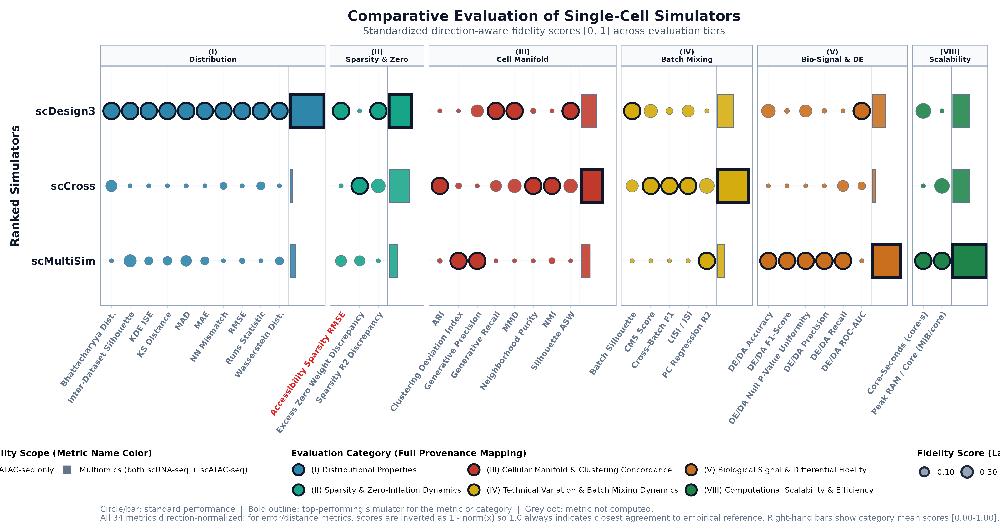
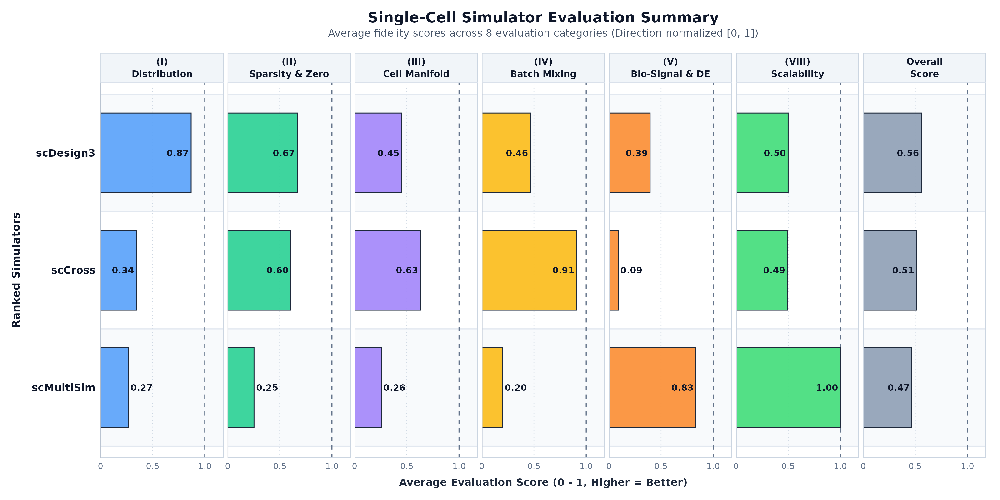
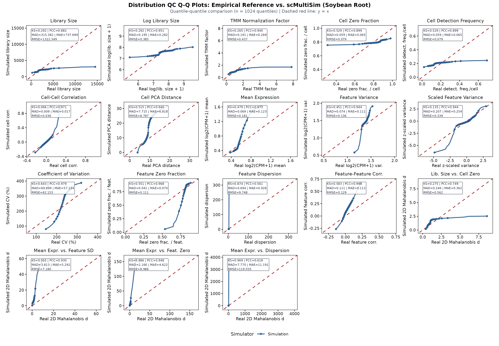
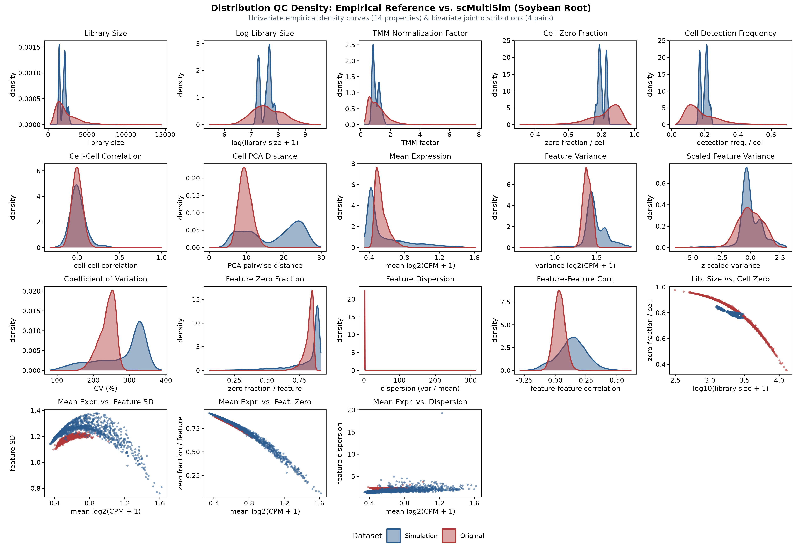
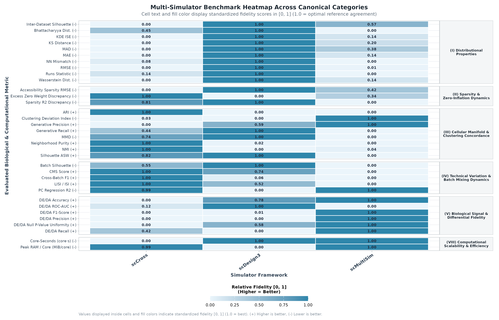
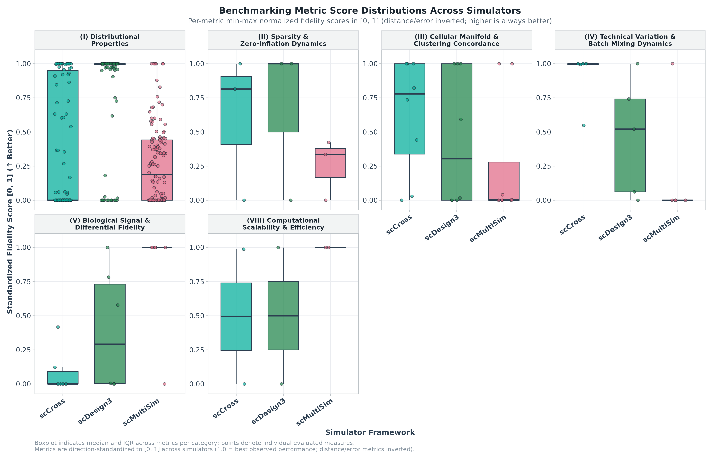
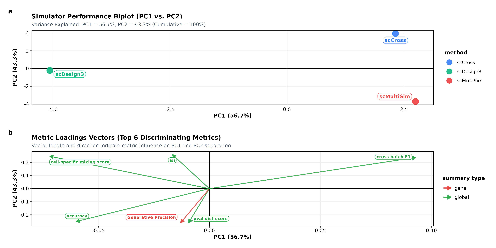
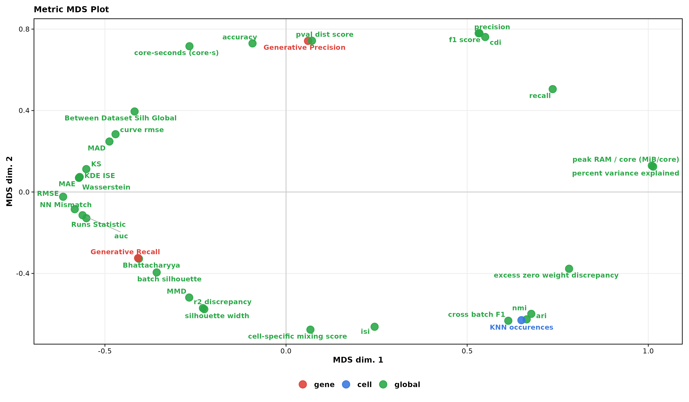
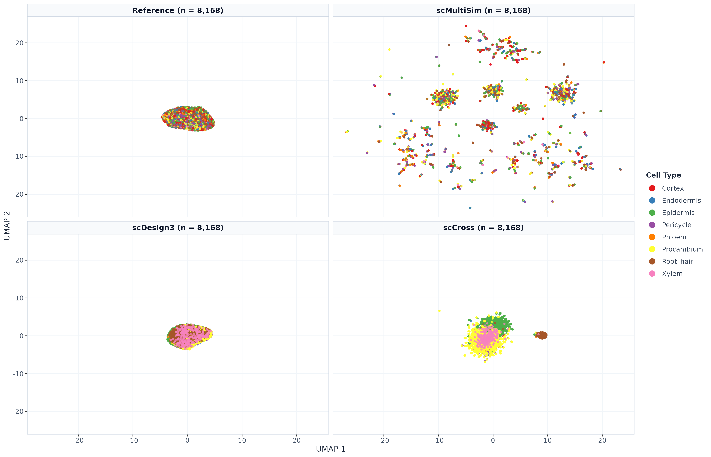
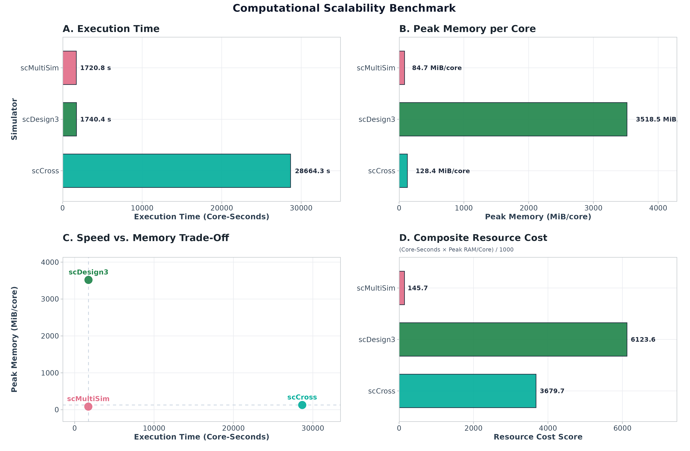

```{r knitr-setup, include = FALSE}
knitr::opts_chunk$set(
  collapse = TRUE,
  comment  = "#>",
  fig.width  = 10,
  fig.height = 6,
  warning  = FALSE,
  message  = FALSE
)
```

# Introduction

Single-cell assay for transposase-accessible chromatin using sequencing (scATAC-seq) profiling provides profound insights into epigenomic regulation, chromatin architecture, and transcription factor occupancy at cellular resolution. In contrast to single-cell transcriptomics, scATAC-seq peak accessibility data present distinct statistical and biophysical features:
* **Extreme Sparsity:** Over 90% to 98% of values in peak-by-cell matrices are zeroes due to the diploid limit (at most 2 genomic copies per cell) and technical capture dropouts.
* **Near-Binary Open/Closed Dynamics:** Raw counts predominantly reflect discrete accessibility (0, 1, or 2 transposase insertions) rather than continuous high-magnitude expression.
* **TF-IDF Normalization:** Feature transformation relies on Term Frequency-Inverse Document Frequency (TF-IDF) rather than $\log_2(\text{CPM} + 1)$ to balance locus-specific accessibility against global sequencing depth.
* **Quadratic Accessibility-Sparsity Relationship:** In empirical datasets, locus detection frequency adheres to a characteristic quadratic curve with respect to mean accessibility.

To ensure computational pipelines, peak-calling algorithms, and cell-type classifiers developed on synthetic data are biologically reliable, researchers require rigorous tools to validate how faithfully simulated scATAC-seq data reproduce real biological experiments.

**`scSimEval`** provides a standardized, reference-based benchmarking framework to systematically quantify single-cell epigenomic simulation fidelity. For unimodal **`scATAC-seq`**, `scSimEval` evaluates synthetic data across **6 active evaluation categories**:

1. **Category I: Distributional Properties** — Univariate statistical distances (Wasserstein, Kolmogorov–Smirnov, MAD, Bhattacharyya) evaluated across cell-level insertion sums, peak detection rates, and Signac/simPIC-standard TF-IDF transformed accessibility coordinates.
2. **Category II: Sparsity & Zero-Inflation Dynamics** — Quadratic accessibility-sparsity curve parameters (curve RMSE, $R^2$ fit discrepancy) and zero-probability profile preservation.
3. **Category III: Cellular Manifold & Clustering Concordance** — Latent epigenomic geometry preservation, Maximum Mean Discrepancy (MMD), Generative Precision & Recall, Average Silhouette Width (ASW), Adjusted Rand Index (ARI), and Normalized Mutual Information (NMI).
4. **Category IV: Technical Variation & Batch Mixing Dynamics** — Batch Silhouette Width, Principal Component Regression ($PCR\ R^2$), Cell-Specific Mixing Score (CMS), Inverse Simpson's Index (ISI), and cross-batch cell-type classification transfer F1.
5. **Category V: Biological Signal & Differential Accessibility (DA) Fidelity** — Pseudobulk `edgeR-QLF` statistical testing across biological replicates assessing null $p$-value uniformity, marker peak detection accuracy, precision, recall, F1-score, and ROC-AUC.
6. **Category VIII: Computational Scalability & Efficiency** — Hardware-normalized execution runtime (`core_seconds`), resident peak memory per allocated core (`memory_per_core_mib`), simulation throughput (cells/second), and speed-memory trade-offs.

> **Note on Categories VI & VII:** Category VI (*Multiomics Integration & Alignment*) evaluates cross-modality latent alignment between paired or unpaired scRNA-seq and scATAC-seq co-assays, and Category VII (*Trajectory & Lineage Topology*) requires continuous transcriptional kinetics. Both are naturally inactive for unimodal scATAC-seq evaluations.

### Direction-Aware Score Normalization

Raw metrics span disparate physical units (Kolmogorov–Smirnov distances, runtimes in seconds, RAM in MiB, correlation coefficients). `scSimEval` standardizes all raw metrics into **direction-aware fidelity scores in $[0, 1]$**, where **$1.0$ indicates perfect biological fidelity**:
* For distance and error metrics where lower values represent superior accuracy (e.g., Wasserstein, MMD, accessibility-sparsity RMSE), scores are inverted: $\text{Score} = \exp(-\gamma \cdot \text{distance})$.
* For bounded concordance indices where higher values represent superior fidelity (e.g., ARI, NMI, Generative Precision, DA ROC-AUC), scores are scaled linearly to $[0, 1]$.
* For mixing and balance metrics where values closer to zero indicate optimal batch mixing without clustering artifacts (e.g., Batch Silhouette), scores are centered symmetrically.

---

# 1. Input Data Requirements & Object Setup

To benchmark any scATAC-seq simulation, `scSimEval` requires an empirical reference alongside simulated candidate datasets:

1. **Empirical Biological Reference (`ref_data`):**
   - A peak-by-cell count matrix or serialized `Seurat` / `SingleCellExperiment` object containing scATAC-seq peak insertion counts.
   - **Cell-Type Annotations (`cell_types` — Mandatory):** Character vector or factor identifying biological cell types. Required for manifold concordance (Category III) and pseudobulk differential accessibility testing (Category V).
   - **Batch Identifiers (`batch_info` — Mandatory):** Character vector or factor identifying technical batches or donor replicates. Required for batch mixing dynamics (Category IV) and pseudobulk replicate design matrices.

2. **Simulated Datasets (`sim_data`):**
   - One or more synthetic peak accessibility matrices generated by candidate simulation algorithms, accompanied by corresponding cell-type and batch annotations.

3. **Computational Resource Logs (Optional / Category VIII):**
   - Simulation elapsed wall-clock time (`elapsed_time`), peak resident memory consumption (`memory_mb`), and the number of CPU cores allocated during simulation (`sim_cores`).

### Illustrative Case Study: 3 State-of-the-Art Simulators

In this demonstration, we benchmark **3 representative single-cell multiomics simulators** configured to simulate scATAC-seq peak accessibility data from an empirical biological reference (soybean root tissue: 6,000 genomic peak loci $\times$ 8,168 single cells across 8 annotated cell types and 5 biological batches):
1. **`scMultiSim`** (Multi-modal kinetic and spatial simulator modeling joint transcriptomic and chromatin accessibility profiles)
2. **`scDesign3`** (Unified probabilistic copula model with customizable distribution families)
3. **`scCross`** (Cross-modality generative adversarial network modeling non-linear epigenomic-transcriptomic couplings)

Empirical execution wall-clock runtimes and peak RAM consumption tracked during data simulation under high-performance computing allocations are summarized below:

| Simulator | Wall-Clock Runtime (s) | Peak Resident Memory | Memory Unit | CPU Cores |
|:---|:---:|:---:|:---:|:---:|
| **scMultiSim** | 107.55 | 1354.50 | MiB | 16 |
| **scDesign3** | 435.10 | 14073.90 | MiB | 4 |
| **scCross** | 1791.52 | 2153.70 | MB | 16 |

---

# 2. Running the Unified Benchmarking Pipeline

The master evaluation entrypoint in `scSimEval` is `evaluate_simulation_accuracy()`. It automatically identifies the analysis modality as scATAC-seq, applies TF-IDF transformations where appropriate, evaluates accessibility-sparsity dynamics, runs pseudobulk differential testing, and standardizes all scores.

### 2.1 Benchmarking a Single Simulator

For evaluating a single simulator against an empirical reference:

```r
library(scSimEval)

# Run full evaluation across all active scATAC-seq categories
eval_result <- evaluate_simulation_accuracy(
  ref_data          = ref_seurat,          # Reference peak-by-cell matrix or Seurat object
  sim_data          = sim_seurat,          # Simulated peak-by-cell matrix or Seurat object
  cell_types_ref    = ref_seurat$cell_type,# Reference cell types
  cell_types_sim    = sim_seurat$cell_type,# Simulated cell types
  batch_ref         = ref_seurat$batch,    # Reference batch identifiers
  batch_sim         = sim_seurat$batch,    # Simulated batch identifiers
  modality          = "scATAC-seq",        # Analysis modality
  elapsed_time      = 107.55,              # Simulation runtime in seconds
  time_unit         = "seconds",
  memory_mb         = 1354.50,             # Simulation peak RAM
  memory_unit       = "MiB",
  sim_cores         = 16L,                 # Allocated simulation cores
  compute_bivariate = FALSE,
  threads           = 16,                  # Multiprocessing threads for evaluation
  verbose           = TRUE
)

# Inspect tidy metrics summary table
head(eval_result$metrics_summary_table)
```

### 2.2 Benchmarking Multiple Simulators in Batch Mode

When comparing multiple simulation algorithms, users can iterate over a configured list of simulator outputs:

```r
# Define list of candidate simulators and their scalability parameters
simulator_suite <- list(
  scMultiSim = list(obj = obj_scmultisim, time = 107.55,  mem = 1354.50,  mem_u = "MiB", cores = 16L),
  scDesign3  = list(obj = obj_scdesign3,  time = 435.10,  mem = 14073.90, mem_u = "MiB", cores = 4L),
  scCross    = list(obj = obj_sccross,    time = 1791.52, mem = 2153.70,  mem_u = "MB",  cores = 16L)
)

all_benchmark_results <- list()

for (sim_name in names(simulator_suite)) {
  cfg <- simulator_suite[[sim_name]]
  cat("[scSimEval] Benchmarking:", sim_name, "...\n")
  
  eval_out <- evaluate_simulation_accuracy(
    ref_data          = ref_seurat,
    sim_data          = cfg$obj,
    cell_types_ref    = ref_seurat$cell_type,
    cell_types_sim    = cfg$obj$cell_type,
    batch_ref         = ref_seurat$batch,
    batch_sim         = cfg$obj$batch,
    modality          = "scATAC-seq",
    elapsed_time      = cfg$time,
    time_unit         = "seconds",
    memory_mb         = cfg$mem,
    memory_unit       = cfg$mem_u,
    sim_cores         = cfg$cores,
    compute_bivariate = FALSE,
    threads           = 16,
    verbose           = FALSE
  )
  
  tbl <- eval_out$metrics_summary_table
  tbl$Method  <- sim_name
  tbl$Dataset <- "scATAC-seq Benchmark"
  if (!"Score" %in% colnames(tbl) && "Value" %in% colnames(tbl)) tbl$Score <- tbl$Value
  all_benchmark_results[[sim_name]] <- standardize_benchmark_categories(tbl)
}

# Consolidate into unified benchmark data frame
final_benchmark_df <- do.call(rbind, all_benchmark_results)
final_benchmark_df <- standardize_benchmark_categories(final_benchmark_df)
saveRDS(final_benchmark_df, "scSimEval_benchmark_results.rds")
```

---

# 3. Inspecting Benchmark Results Across Evaluation Categories

```{r load-results, echo = FALSE}
# Load pre-computed benchmark results archive
res_file <- "scSimEval_benchmark_results.rds"
if (!file.exists(res_file)) {
  res_file <- "/root/scSimEval_analysis/demo_analysis/scATAC-seq_soy_root/scSimEval_benchmark_results.rds"
}
if (!file.exists(res_file)) {
  res_file <- system.file("extdata", "scSimEval_benchmark_results.rds", package = "scSimEval")
}
final_benchmark_df <- readRDS(res_file)
```

The resulting evaluation table contains standardized columns:
* **`Dataset`**: Evaluated biological reference dataset.
* **`Method`**: Candidate simulator evaluated.
* **`Category`**: One of the 6 active evaluation categories.
* **`Metric`**: Standardized metric identifier.
* **`Score_Raw`**: Unnormalized raw empirical value (physical unit: seconds, MiB, KS statistic, correlation).
* **`Score`**: Standardized direction-aware fidelity score normalized to $[0, 1]$ ($1.0 = \text{best}$).

Below we inspect representative metric scores across each evaluated category:

### 3.1 Category I: Global & Marginal Distributional Properties
Assesses univariate goodness-of-fit across cell insertion depths, peak accessibility rates, means, and variances under TF-IDF transformation:

```{r cat1-inspect}
head(subset(final_benchmark_df, grepl("Distributional", Category))[, c("Method", "Property", "Metric", "Value", "Score")], 5)
```

### 3.2 Category II: Sparsity & Zero-Inflation Dynamics
Quantifies accessibility-sparsity quadratic curve fidelity ($R^2$ fit discrepancy, curve RMSE) and peak dropout probability dynamics:

```{r cat2-inspect}
head(subset(final_benchmark_df, grepl("Sparsity", Category))[, c("Method", "Property", "Metric", "Value", "Score")], 5)
```

### 3.3 Category III: Cellular Manifold & Clustering Concordance
Measures Maximum Mean Discrepancy (MMD), generative precision and recall (sample quality vs. diversity), cluster separation (ASW), ARI, and NMI on TF-IDF/LSI embeddings:

```{r cat3-inspect}
head(subset(final_benchmark_df, grepl("Manifold", Category))[, c("Method", "Property", "Metric", "Value", "Score")], 5)
```

### 3.4 Category IV: Technical Variation & Batch Mixing Dynamics
Evaluates batch silhouette widths, Principal Component Regression ($PCR\ R^2$), Cell-Specific Mixing Scores (CMS), and cross-batch cell-type classification transfer F1:

```{r cat4-inspect}
head(subset(final_benchmark_df, grepl("Batch", Category))[, c("Method", "Property", "Metric", "Value", "Score")], 5)
```

### 3.5 Category V: Biological Signal & Differential Accessibility (DA) Fidelity
Evaluates pseudobulk `edgeR-QLF` testing on binarized chromatin peaks across biological replicates, assessing marker peak recovery accuracy, precision, recall, and ROC-AUC:

```{r cat5-inspect}
head(subset(final_benchmark_df, grepl("Differential", Category))[, c("Method", "Property", "Metric", "Value", "Score")], 5)
```

### 3.6 Category VIII: Computational Scalability & Efficiency
Quantifies hardware-normalized resource expenditure in cumulative core-seconds and resident peak memory per allocated core:

```{r cat8-inspect}
head(subset(final_benchmark_df, grepl("Scalability", Category))[, c("Method", "Property", "Metric", "Value", "Score")], 6)
```

---

# 4. Publication-Grade Comparative Visualizations

`scSimEval` provides an integrated suite of publication-grade visualization functions designed to compare multiple simulators across biological and computational dimensions. All figures below are rendered directly with **direction-aware normalized scores**.

### 4.1 Comparative Bubble Matrix

The comparative bubble matrix provides a high-level overview of the entire benchmarking study. Each column represents an individual evaluation metric, grouped by category, while each row represents a simulator. Bubble size and color gradient encode the normalized fidelity score $[0, 1]$:

```r
p_bubble <- plot_benchmark_bubble_matrix(final_benchmark_df, base_size = 12)
ggsave("figures/scATAC_benchmark_bubble_matrix.png", plot = p_bubble, width = 16, height = 8.5, dpi = 300)
```

```{r fig-bubble, echo = FALSE, out.width = "100%", fig.cap = "**Figure 1: Comparative Bubble Matrix across scATAC-seq evaluation metrics.** Visualizes normalized fidelity scores across all 6 active categories for the 3 evaluated single-cell epigenomic simulation algorithms."}

```

---

### 4.2 Evaluation Summary Visualization

A synthesized radar/polar overview summarizing mean normalized fidelity scores across all active categories, highlighting the global strengths and trade-offs of each simulator:

```r
p_summary <- plot_evaluation_summary(final_benchmark_df, normalize_scores = TRUE, base_size = 11)
ggsave("figures/scATAC_evaluation_summary.png", plot = p_summary, width = 14, height = 7, dpi = 300)
```

```{r fig-summary, echo = FALSE, out.width = "100%", fig.cap = "**Figure 2: Overall Simulator Evaluation Summary.** Polar chart displaying category-level composite scores across the 6 evaluated dimensions."}

```

---

### 4.3 Distribution QC Diagnostics: Q-Q Plots and Empirical Density

`plot_distribution_qc()` provides in-depth distributional diagnostics comparing empirical reference distributions directly against synthetic data generated by a simulator:

```r
# Quantile-Quantile (Q-Q) plots for marginal properties
p_qc_qq <- plot_distribution_qc(
  ref_data = ref_matrix,
  sim_data = sim_matrix,
  layout   = "qq",
  title    = "Distribution QC Q-Q: Reference vs. Simulator"
)
ggsave("figures/scATAC_distribution_qc_qq.png", plot = p_qc_qq, width = 13, height = 9, dpi = 300)

# Continuous probability density overlays
p_qc_density <- plot_distribution_qc(
  ref_data = ref_matrix,
  sim_data = sim_matrix,
  layout   = "density",
  title    = "Distribution QC Density: Reference vs. Simulator"
)
ggsave("figures/scATAC_distribution_qc_density.png", plot = p_qc_density, width = 13, height = 9, dpi = 300)
```

```{r fig-qc-qq, echo = FALSE, out.width = "100%", fig.cap = "**Figure 3A: Distribution QC Quantile-Quantile (Q-Q) Diagnostics.** Aligns quantiles of simulated library size, peak accessibility rate, feature means, and feature variances against the reference dataset."}

```

```{r fig-qc-density, echo = FALSE, out.width = "100%", fig.cap = "**Figure 3B: Distribution QC Empirical Density Overlays.** Compares empirical probability density curves between empirical reference and synthetic counts across marginal properties."}

```

---

### 4.4 Metric Heatmap

A hierarchically clustered heatmap displaying relative simulator performance across all evaluated metrics:

```r
p_heatmap <- plot_metric_heatmap(final_benchmark_df, scale_fill = "relative", base_size = 10)
ggsave("figures/scATAC_metric_heatmap.png", plot = p_heatmap, width = 14, height = 9, dpi = 300)
```

```{r fig-heatmap, echo = FALSE, out.width = "100%", fig.cap = "**Figure 4: Relative Metric Heatmap.** Hierarchically clustered evaluation scores across all metrics, identifying simulator clusters and characteristic performance profiles."}

```

---

### 4.5 Metric Score Distributions Across Categories (Multi-Panel Boxplots)

`plot_metric_boxplots()` combines evaluation scores across all active categories into a unified multi-panel visualization, illustrating score distributions, median fidelity, and variance across candidate simulators:

```r
p_boxplots <- plot_metric_boxplots(final_benchmark_df, base_size = 10)
ggsave("figures/scATAC_metric_boxplots.png", plot = p_boxplots, width = 14, height = 9, dpi = 300)
```

```{r fig-boxplots, echo = FALSE, out.width = "100%", fig.cap = "**Figure 5: Metric Score Distributions Across Evaluation Categories.** Multi-panel boxplot displaying the distribution and spread of normalized evaluation scores across all candidate simulators across active evaluation categories."}

```

---

### 4.6 Principal Component Analysis (PCA) Ordination

`plot_metric_pca()` projects simulators and evaluation metrics onto orthogonal axes of variation, highlighting which metrics drive divergence among simulation algorithms:

```r
p_pca <- plot_metric_pca(final_benchmark_df, panel = "both", top_n_loadings = 6, base_size = 11)
ggsave("figures/scATAC_pca_ordination.png", plot = p_pca, width = 13, height = 6.5, dpi = 300)
```

```{r fig-pca, echo = FALSE, out.width = "100%", fig.cap = "**Figure 6: PCA Ordination Biplot.** Joint projection of simulators (sample space) and top 6 influential metric loadings (feature space)."}

```

---

### 4.7 Multidimensional Scaling (MDS) Metric Space

`plot_metric_mds()` computes pairwise distances among simulators across summary metrics to visualize simulator proximity and family clustering:

```r
p_mds <- plot_metric_mds(final_benchmark_df, ordination_by = "summaries", normalize_scores = TRUE, base_size = 11)
ggsave("figures/scATAC_mds_metric_space.png", plot = p_mds, width = 12, height = 7, dpi = 300)
```

```{r fig-mds, echo = FALSE, out.width = "100%", fig.cap = "**Figure 7: Multidimensional Scaling (MDS) Metric Space.** Ordination visualizing global similarity among simulation methods based on summary metric profiles."}

```

---

### 4.8 UMAP Embeddings Grid Across Simulators

`plot_dataset_embeddings()` embeds empirical reference cells and synthetic cells from all candidate simulators into a shared 2D latent space, colored by cell type:

```r
# Compute unified 2D UMAP coordinates
embedding_df <- compute_dataset_embeddings(
  reference  = ref_matrix,
  simulated  = list_of_sim_counts,
  reduction  = "umap",
  cell_types = list_of_cell_types,
  seed       = 42
)

# Plot faceted comparison grid
p_umap <- plot_dataset_embeddings(
  embedding_data = embedding_df,
  reduction      = "umap",
  layout         = "facet",
  color_by       = "cell_type",
  base_size      = 11
)
ggsave("figures/scATAC_umap_grid.png", plot = p_umap, width = 14, height = 9, dpi = 300)
```

```{r fig-umap, echo = FALSE, out.width = "100%", fig.cap = "**Figure 8: Faceted UMAP Embeddings Grid.** Compares 2D cellular manifold geometry and cluster separation across the empirical reference and all 3 candidate simulators, colored by cell type."}

```

---

### 4.9 Computational Scalability Benchmark (Combined 4-Panel)

`plot_scalability_benchmark()` generates a standardized 4-panel evaluation assessing core-seconds runtime, peak RAM per allocated core, cell throughput, and computational efficiency trade-offs:

```r
p_scalability <- plot_scalability_benchmark(
  benchmark_data = final_benchmark_df,
  type           = "composite",
  layout         = "4panel",
  modality       = "total",
  time_unit      = "core_seconds",
  memory_unit    = "MiB/core",
  base_size      = 11
)
ggsave("figures/scATAC_scalability_benchmark.png", plot = p_scalability, width = 13, height = 8.5, dpi = 300)
```

```{r fig-scalability, echo = FALSE, out.width = "100%", fig.cap = "**Figure 9: Composite 4-Panel Computational Scalability Benchmark.** Evaluates execution runtime (core-seconds), peak resident memory (MiB/core), cell throughput, and speed-memory trade-offs across simulators."}

```

---

# 5. Session Information

```{r session-info}
sessionInfo()
```
