```{r knitr-setup, include = FALSE}
knitr::opts_chunk$set(
  collapse = TRUE,
  comment = "#>",
  fig.width = 10,
  fig.height = 6,
  warning = FALSE,
  message = FALSE
)
```

# Overview

Single-cell RNA sequencing (scRNA-seq) simulation algorithms generate synthetic expression counts to evaluate computational pipelines, cluster detection, and differential expression methods. Quantifying whether synthetic data accurately captures the complex statistical distributions, cell-type manifolds, batch variations, and biological trajectories of real experimental data is critical.

This tutorial provides a step-by-step demonstration of evaluating synthetic scRNA-seq datasets using **`scSimEval`**. We benchmark **6 state-of-the-art single-cell simulators** against an empirical biological reference from rice bud tissue (*Oryza sativa*).

---

# 1. Dataset Preparation & Experimental Design

### 1.1 Empirical Reference & Simulation Suites

We evaluate an empirical biological reference and 6 simulated datasets derived from rice bud tissue:

* **Reference Dataset**: Rice bud tissue (*Oryza sativa*) containing **1,558 genes** across **2,589 single cells**, with **8 annotated cell types** and **2 technical batches**.
* **Simulated Datasets**: Six simulators configured for the same biological system:
  1. **`scMultiSim`**
  2. **`scDesign3`**
  3. **`MOSim`**
  4. **`scCross`**
  5. **`scMoMtF`**
  6. **`Matilda`**

While multiomics Seurat objects may contain multiple modalities (e.g., scRNA and scATAC), `scSimEval` cleanly isolates the `RNA` counts assay and preserves cell-level metadata (cell types and batch annotations).

### 1.2 Computational Scalability Measures

Empirical simulation runtime (wall-clock seconds) and peak RAM consumption were tracked under a standardized 16-core allocation:

| Simulation Method | Wall-Clock Runtime (s) | Peak Memory | Memory Unit | CPU Cores |
|:------------------|:----------------------:|:-----------:|:-----------:|:---------:|
| **scMultiSim**    | 191.89                 | 1139.00     | MiB         | 16        |
| **scDesign3**     | 87.87                  | 5713.90     | MiB         | 16        |
| **MOSim**         | 294.45                 | 1399.50     | MiB         | 16        |
| **scCross**       | 867.68                 | 1322.84     | MB          | 16        |
| **scMoMtF**       | 13.84                  | 339.69      | MB          | 16        |
| **Matilda**       | 57.32                  | 352.26      | MB          | 16        |

---

# 2. Loading Libraries & Data Objects

First, we load `scSimEval`, `Seurat`, and `Matrix`:

```r
library(scSimEval)
library(Matrix)
library(Seurat)
library(ggplot2)
```

### 2.1 Safe scRNA-seq Data Loader

We define a data loader to extract the RNA count matrix and standardize metadata annotations:

```r
load_scrna_seurat <- function(path, placeholder = "dataset") {
  raw_obj <- readRDS(path)
  
  # Extract RNA counts layer safely
  counts_rna <- NULL
  if ("RNA" %in% names(raw_obj@assays)) {
    counts_rna <- tryCatch(raw_obj[["RNA"]]$counts, error = function(e) NULL)
    if (is.null(counts_rna)) {
      counts_rna <- tryCatch(
        Seurat::GetAssayData(raw_obj[["RNA"]], layer = "counts"),
        error = function(e) Seurat::GetAssayData(raw_obj[["RNA"]], slot = "counts")
      )
    }
  } else {
    def_a <- Seurat::DefaultAssay(raw_obj)
    counts_rna <- tryCatch(
      Seurat::GetAssayData(raw_obj[[def_a]], layer = "counts"),
      error = function(e) Seurat::GetAssayData(raw_obj[[def_a]], slot = "counts")
    )
  }
  
  # Create a pure single-cell RNA Seurat object
  clean_obj <- CreateSeuratObject(counts = counts_rna, meta.data = raw_obj@meta.data)
  
  # Validate structure using scSimEval
  val <- validate_sc_object(clean_obj, modality = "scRNA-seq")
  
  # Standardize cell type nomenclature
  ct <- val$cell_types
  if (!is.null(ct)) ct <- sub("^Bud--", "", ct)
  
  list(
    counts     = val$counts,
    object     = val$object,
    cell_types = ct,
    batch_info = val$batch_info
  )
}
```

### 2.2 Loading Reference & Extracting Summary

```r
# Load empirical reference
ref_file <- "/root/seurat_files/reference_datasets/rice/rice_processed_Bud_final.rds"
ref_data <- load_scrna_seurat(ref_file, placeholder = "Reference (Rice_Bud)")

ref_mat <- ref_data$counts
ref_obj <- ref_data$object
ct_ref  <- ref_data$cell_types
bt_ref  <- ref_data$batch_info

cat(sprintf("Reference: %d features x %d cells across %d cell types and %d batches.\n",
            nrow(ref_mat), ncol(ref_mat), length(unique(ct_ref)), length(unique(bt_ref))))
```

```
#> Reference: 1558 features x 2589 cells across 8 cell types and 2 batches.
```

We extract baseline empirical summaries using `extract_dataset_summary()`:

```r
all_dataset_summaries <- list()
all_dataset_summaries[[1]] <- extract_dataset_summary(
  ref_mat,
  role        = "Biological Reference",
  method_name = "Empirical Reference (Rice_Bud)",
  modality    = "scRNA-seq",
  cell_types  = ct_ref,
  batch_info  = bt_ref
)
```

---

# 3. Live Simulation Accuracy Evaluation

We configure the six simulation methods with their scalability values and execute `evaluate_simulation_accuracy()` using **16 CPU cores**:

```r
sim_configs <- list(
  scMultiSim = list(
    name = "scMultiSim",
    file = "/root/seurat_files/simulated_datasets/rice/scMultiSim/scMultiSim_rice_Bud_seurat.rds",
    time = 191.89, time_unit = "seconds", mem = 1139.00, mem_unit = "MiB", cores = 16L
  ),
  scDesign3 = list(
    name = "scDesign3",
    file = "/root/seurat_files/simulated_datasets/rice/scDesign3/scDesign3_rice_Bud_seurat.rds",
    time = 87.87, time_unit = "seconds", mem = 5713.90, mem_unit = "MiB", cores = 16L
  ),
  MOSim = list(
    name = "MOSim",
    file = "/root/seurat_files/simulated_datasets/rice/MOSim/mosim_rice_Bud_seurat.rds",
    time = 294.45, time_unit = "seconds", mem = 1399.50, mem_unit = "MiB", cores = 16L
  ),
  scCross = list(
    name = "scCross",
    file = "/root/seurat_files/simulated_datasets/rice/scCross/scCross_rice_Bud_seurat.rds",
    time = 867.68, time_unit = "seconds", mem = 1322.84, mem_unit = "MB", cores = 16L
  ),
  scMoMtF = list(
    name = "scMoMtF",
    file = "/root/seurat_files/simulated_datasets/rice/scMoMtF/scMoMtF_rice_Bud_seurat.rds",
    time = 13.84, time_unit = "seconds", mem = 339.69, mem_unit = "MB", cores = 16L
  ),
  Matilda = list(
    name = "Matilda",
    file = "/root/seurat_files/simulated_datasets/rice/Matilda/matilda_rice_Bud_seurat.rds",
    time = 57.32, time_unit = "seconds", mem = 352.26, mem_unit = "MB", cores = 16L
  )
)
```

### 3.1 Executing the Benchmarking Loop

```r
all_benchmark_results <- list()
all_sim_counts <- list()

for (cfg in sim_configs) {
  cat("[scSimEval] Evaluating:", cfg$name, "...\n")
  sim_data <- load_scrna_seurat(cfg$file, placeholder = cfg$name)
  all_sim_counts[[cfg$name]] <- sim_data$counts
  
  # Dataset summary
  all_dataset_summaries[[length(all_dataset_summaries) + 1]] <- extract_dataset_summary(
    sim_data$counts, role = "Simulated",
    method_name = paste0(cfg$name, " (Rice_Bud)"),
    modality = "scRNA-seq", cell_types = sim_data$cell_types, batch_info = sim_data$batch_info
  )
  
  # Master evaluation pipeline across 7 relevant unimodal categories
  eval_res <- evaluate_simulation_accuracy(
    ref_data          = ref_obj,
    sim_data          = sim_data$object,
    cell_types_ref    = ct_ref,
    cell_types_sim    = sim_data$cell_types,
    batch_ref         = bt_ref,
    batch_sim         = sim_data$batch_info,
    modality          = "scRNA-seq",
    memory_mb         = cfg$mem,
    elapsed_time      = cfg$time,
    time_unit         = cfg$time_unit,
    memory_unit       = cfg$mem_unit,
    sim_cores         = cfg$cores,
    compute_bivariate = FALSE,
    threads           = 16,
    verbose           = FALSE
  )
  
  tbl <- eval_res$metrics_summary_table
  tbl$Method  <- cfg$name
  tbl$Dataset <- "Rice_Bud"
  if (!"Score" %in% colnames(tbl) && "Value" %in% colnames(tbl)) tbl$Score <- tbl$Value
  
  all_benchmark_results[[cfg$name]] <- standardize_benchmark_categories(tbl)
}

# Consolidate results across all 6 methods
final_benchmark_df <- do.call(rbind, all_benchmark_results)
final_benchmark_df <- standardize_benchmark_categories(final_benchmark_df)
final_summary_df   <- do.call(rbind, all_dataset_summaries)
```

```
#> [scSimEval] Consolidating results across methods...
#> Total evaluated metric entries: 1020 across 6 simulation methods.
```

---

# 4. Exploring Benchmark Results Across Categories

The resulting `metrics_summary_table` aggregates quantitative scores across all evaluation categories. Below we inspect the top entries of each category:

```{r load-results, echo = FALSE}
final_benchmark_df <- readRDS("/root/scSimEval_analysis/demo_analysis/scRNA-seq_rice_bud/scSimEval_benchmark_results.rds")
```

### 4.1 Category I: Global & Marginal Distributions
Assesses univariate goodness-of-fit across library size, feature means, and feature variances:

```{r cat1-inspect}
head(subset(final_benchmark_df, grepl("Distributional", Category))[, c("Method", "Property", "Metric", "Value", "Score")], 5)
```

### 4.2 Category II: Sparsity & Zero-Inflation Dynamics
Quantifies dropout curve concordance, slope discrepancies, and logistic zero-probability dynamics:

```{r cat2-inspect}
head(subset(final_benchmark_df, grepl("Sparsity", Category))[, c("Method", "Property", "Metric", "Value", "Score")], 5)
```

### 4.3 Category III: Cellular Manifold & Clustering Concordance
Measures Maximum Mean Discrepancy (MMD), generative precision and recall, and cluster boundary preservation:

```{r cat3-inspect}
head(subset(final_benchmark_df, grepl("Manifold", Category))[, c("Method", "Property", "Metric", "Value", "Score")], 5)
```

### 4.4 Category IV: Technical Variation & Batch Mixing Dynamics
Evaluates batch silhouette widths, Principal Component Regression ($R^2$), and Cell-specific Mixing Scores (CMS):

```{r cat4-inspect}
head(subset(final_benchmark_df, grepl("Batch", Category))[, c("Method", "Property", "Metric", "Value", "Score")], 5)
```

### 4.5 Category V: Biological Signal & Differential Expression (DEG) Fidelity
Assesses marker gene identification accuracy, p-value distribution divergence, and effect size conservation:

```{r cat5-inspect}
head(subset(final_benchmark_df, grepl("Differential", Category))[, c("Method", "Property", "Metric", "Value", "Score")], 5)
```

### 4.6 Category VII: Trajectory & Lineage Topology
Benchmarks milestone graph topology similarity (HIM, edge flip), geodesic distances, branch assignment F1, and Random Forest feature importance correlation:

```{r cat7-inspect}
head(subset(final_benchmark_df, grepl("Trajectory", Category))[, c("Method", "Property", "Metric", "Value", "Score")], 5)
```

### 4.7 Category VIII: Computational Scalability & Efficiency
Quantifies hardware-normalized resource expenditure in cumulative core-seconds and resident peak memory per allocated core:

```{r cat8-inspect}
head(subset(final_benchmark_df, grepl("Scalability", Category))[, c("Method", "Property", "Metric", "Value", "Score")], 6)
```

---

# 5. Diagnostic Visualizations

`scSimEval` includes publication-grade visualization functions designed for multi-simulator comparative analysis. All figures below are rendered directly with normalized scores.

### 5.1 Comparative Bubble Matrix

The comparative bubble matrix visualizes metric scores across all evaluation categories, with circle size and color gradient encoding normalized simulator fidelity:

```r
p_bubble <- plot_benchmark_bubble_matrix(final_benchmark_df, base_size = 12)
ggsave("figures/scSimEval_benchmark_bubble_matrix.png", plot = p_bubble, width = 18, height = 9, dpi = 300)
```

```{r fig-bubble, echo = FALSE, out.width = "100%", fig.cap = "**Figure 1**: Comparative Bubble Matrix Benchmarking 6 Simulators Across All Evaluation Measures on Rice Bud scRNA-seq."}
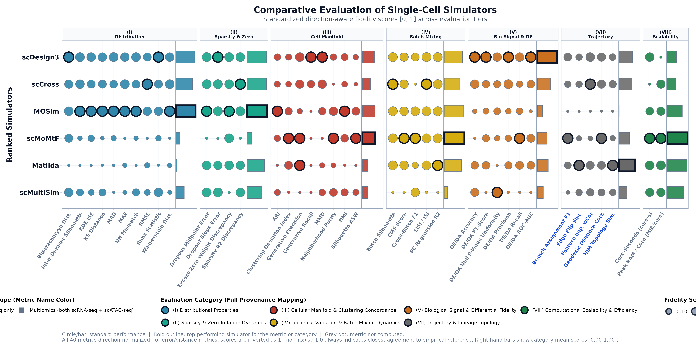
```

---

### 5.2 Evaluation Summary Visualization

A synthesized radar/polar bar overview summarizing average normalized scores across all categories:

```r
p_summary <- plot_evaluation_summary(final_benchmark_df, normalize_scores = TRUE, base_size = 11)
ggsave("figures/scSimEval_evaluation_summary.png", plot = p_summary, width = 14, height = 7, dpi = 300)
```

```{r fig-summary, echo = FALSE, out.width = "100%", fig.cap = "**Figure 2**: Overall Simulator Evaluation Summary Across Categories."}
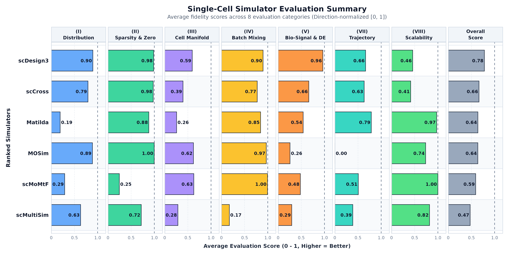
```

---

### 5.3 Distribution QC: Q-Q Plots and Empirical & Joint Density

Detailed quantile-quantile (Q-Q) and density plots comparing empirical reference distributions against a selected simulator (`Matilda`):

```r
# Q-Q Plots for Library Size, Mean, Variance, and Zero Fractions
p_qc_qq <- plot_distribution_qc(
  ref_data = ref_mat,
  sim_data = all_sim_counts[["Matilda"]],
  layout   = "qq",
  title    = "Distribution QC Q-Q: Reference vs. Matilda"
)
ggsave("figures/scSimEval_distribution_qc_qq.png", plot = p_qc_qq, width = 13, height = 9, dpi = 300)

# Density Plots for Marginal Distributions
p_qc_density <- plot_distribution_qc(
  ref_data = ref_mat,
  sim_data = all_sim_counts[["Matilda"]],
  layout   = "density",
  title    = "Distribution QC Density: Reference vs. Matilda"
)
ggsave("figures/scSimEval_distribution_qc_density.png", plot = p_qc_density, width = 13, height = 9, dpi = 300)
```

```{r fig-qc-qq, echo = FALSE, out.width = "100%", fig.cap = "**Figure 3A**: Distribution QC Quantile-Quantile (Q-Q) Diagnostics (Matilda vs. Reference)."}
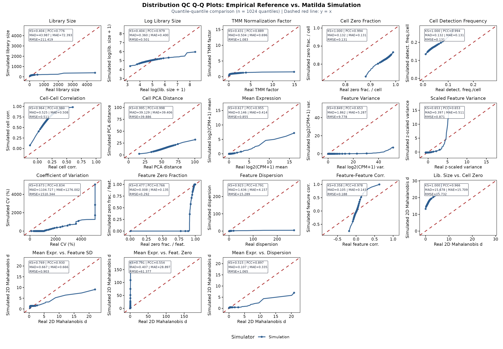
```

```{r fig-qc-density, echo = FALSE, out.width = "100%", fig.cap = "**Figure 3B**: Distribution QC Empirical and Joint Density Distributions (Matilda vs. Reference)."}
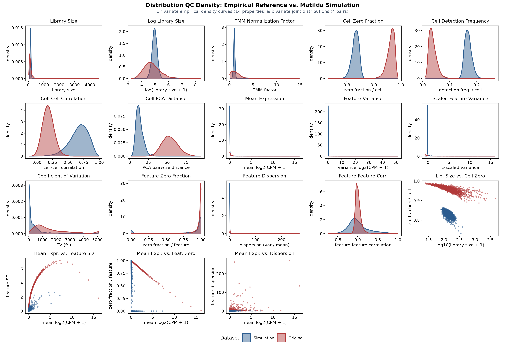
```

---

### 5.4 Metric Heatmap

Heatmap showing relative performance scores across simulators:

```r
p_heatmap <- plot_metric_heatmap(final_benchmark_df, scale_fill = "relative", base_size = 10)
ggsave("figures/scSimEval_metric_heatmap.png", plot = p_heatmap, width = 15, height = 10, dpi = 300)
```

```{r fig-heatmap, echo = FALSE, out.width = "100%", fig.cap = "**Figure 4**: Relative Metric Heatmap Across Simulation Methods."}
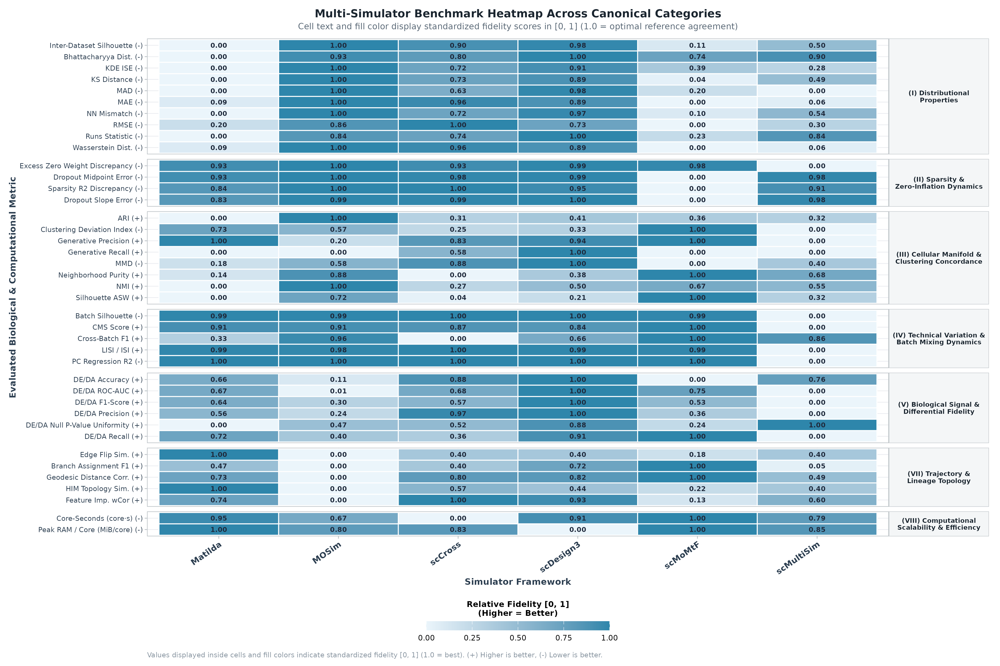
```

---

### 5.5 Metric Plots by Category Group

Detailed score breakdowns for each individual evaluation category:

```r
cats <- unique(final_benchmark_df$Category)
for (cat_name in cats) {
  p_cat <- plot_category_metric_bars(final_benchmark_df, category = cat_name, score_type = "normalized")
  ggsave(paste0("figures/scSimEval_metric_bars_", gsub("[^A-Za-z0-9]", "_", cat_name), ".png"),
         plot = p_cat, width = 12, height = 8, dpi = 300)
}
```

```{r fig-cat1, echo = FALSE, out.width = "100%", fig.cap = "**Figure 5A**: Category I Distributional Properties Score Breakdown."}
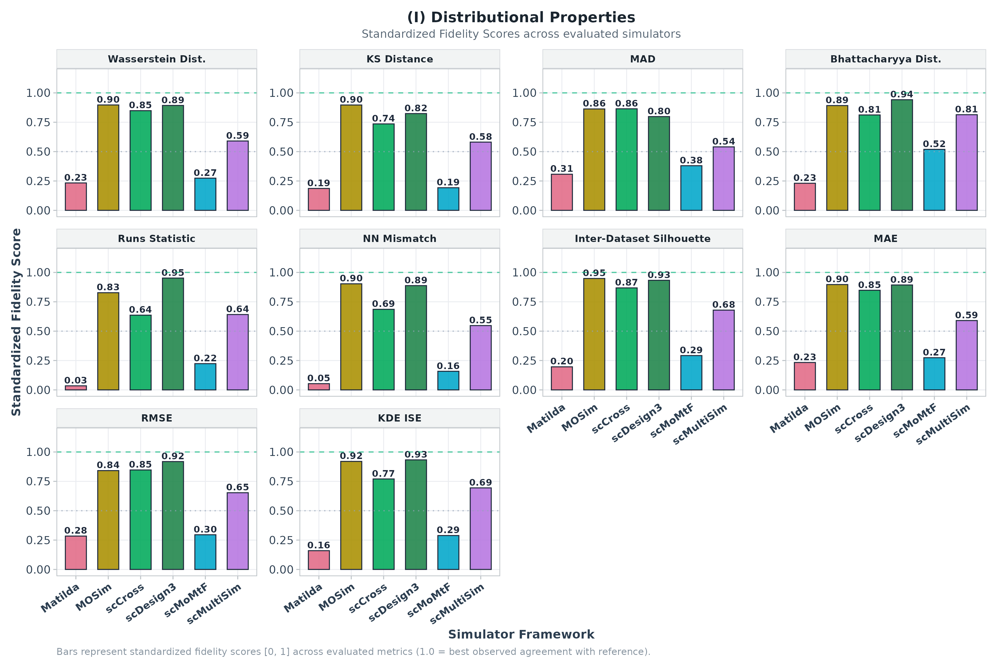
```

```{r fig-cat3, echo = FALSE, out.width = "100%", fig.cap = "**Figure 5B**: Category III Cellular Manifold & Clustering Concordance Breakdown."}
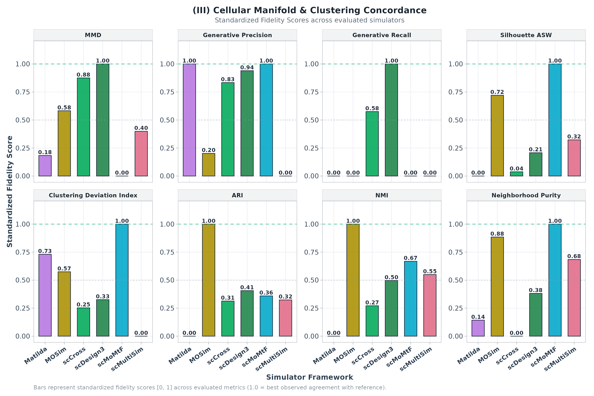
```

```{r fig-cat5, echo = FALSE, out.width = "100%", fig.cap = "**Figure 5C**: Category V Biological Signal & Differential Expression Fidelity Breakdown."}
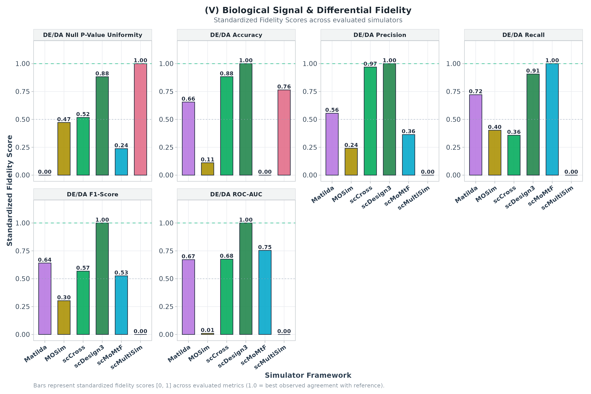
```

---

### 5.6 PCA Ordination Plot

Joint principal component analysis projecting simulators and metric loadings, labeling the top 8 influential metrics:

```r
p_pca <- plot_metric_pca(final_benchmark_df, panel = "both", top_n_loadings = 8, base_size = 11)
ggsave("figures/scSimEval_pca_ordination.png", plot = p_pca, width = 13, height = 6.5, dpi = 300)
```

```{r fig-pca, echo = FALSE, out.width = "100%", fig.cap = "**Figure 6**: Principal Component Analysis (PCA) Ordination of Simulators and Metric Loadings."}
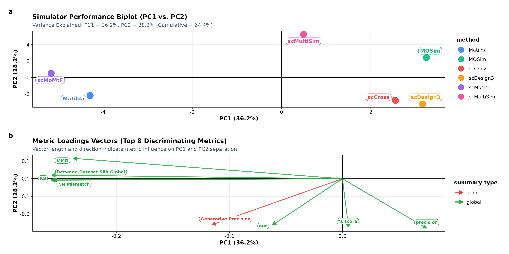
```

---

### 5.7 Multidimensional Scaling (MDS) Metric Space

Multidimensional scaling displaying simulator clustering across metric summaries:

```r
p_mds <- plot_metric_mds(final_benchmark_df, ordination_by = "summaries", normalize_scores = TRUE, base_size = 11)
ggsave("figures/scSimEval_mds_metric_space.png", plot = p_mds, width = 12, height = 7, dpi = 300)
```

```{r fig-mds, echo = FALSE, out.width = "100%", fig.cap = "**Figure 7**: Multidimensional Scaling (MDS) Ordination across Metric Summaries."}
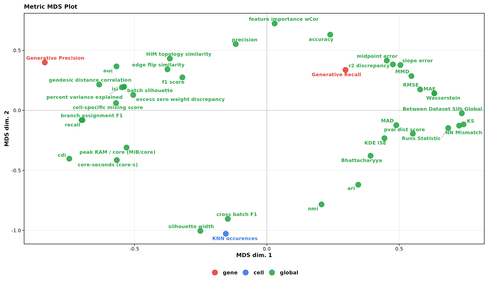
```

---

### 5.8 UMAP Embeddings Grid Across Simulators

Unified UMAP projection comparing empirical reference cells with synthetic cells from each simulator, colored by cell type:

```r
# Compute 2D UMAP coordinates
embedding_df <- compute_dataset_embeddings(
  reference  = ref_mat,
  simulated  = all_sim_counts,
  reduction  = "umap",
  cell_types = c(list(Reference = ct_ref), all_sim_celltypes),
  seed       = 42
)

# Plot faceted UMAP grid
p_umap <- plot_dataset_embeddings(
  embedding_data = embedding_df,
  reduction      = "umap",
  layout         = "facet",
  color_by       = "cell_type",
  base_size      = 11
)
ggsave("figures/scSimEval_umap_grid.png", plot = p_umap, width = 15, height = 10, dpi = 300)
```

```{r fig-umap, echo = FALSE, out.width = "100%", fig.cap = "**Figure 8**: Faceted UMAP Embeddings Grid Colored by Annotated Cell Types (Reference vs. 6 Simulators)."}
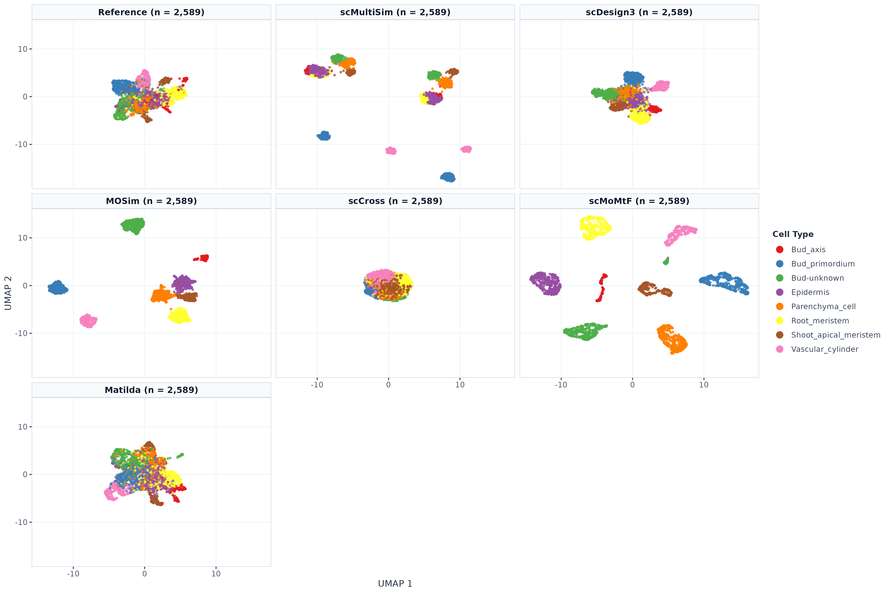
```

---

### 5.9 Computational Scalability Benchmark (Combined 4-Panel)

Composite 4-panel evaluation displaying execution runtime (core-seconds), resident memory (MiB/core), throughput, and efficiency trade-offs:

```r
p_scalability <- plot_scalability_benchmark(
  benchmark_data = final_benchmark_df,
  type           = "composite",
  layout         = "4panel",
  modality       = "total",
  time_unit      = "core_seconds",
  memory_unit    = "MiB/core",
  base_size      = 11
)
ggsave("figures/scSimEval_scalability_benchmark.png", plot = p_scalability, width = 13, height = 8.5, dpi = 300)
```

```{r fig-scalability, echo = FALSE, out.width = "100%", fig.cap = "**Figure 9**: Composite 4-Panel Computational Scalability Benchmark."}
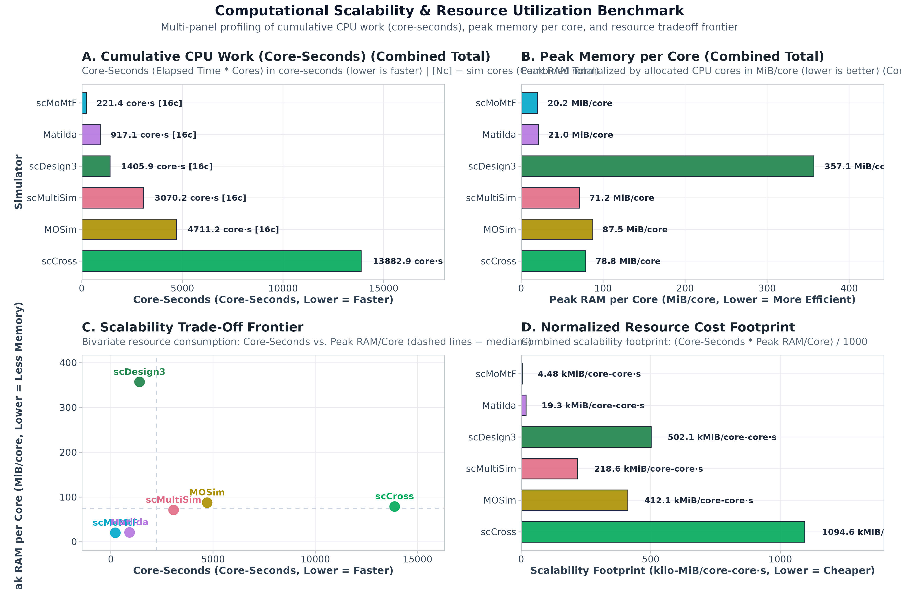
```

---

# 6. Conclusion

This tutorial demonstrated the end-to-end benchmarking of 6 single-cell RNA simulation methods on rice bud tissue. Through `scSimEval`, researchers can rigorously evaluate statistical distributional fidelity, zero patterns, clustering integrity, batch effects, differential expression conservation, trajectory topology, and hardware scalability.

---

# 7. Session Information

```{r session-info}
sessionInfo()
```
