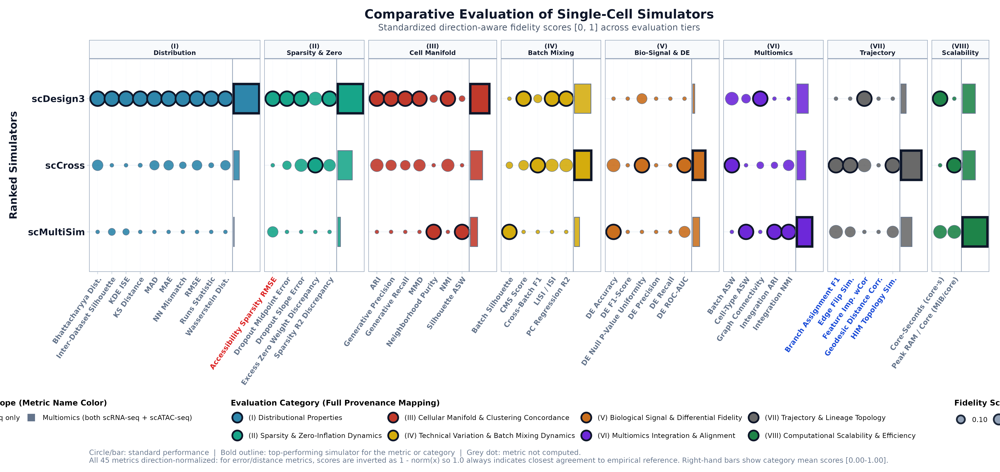
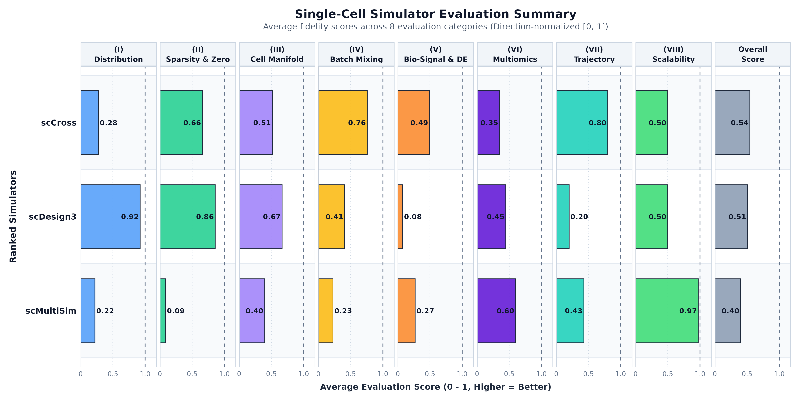
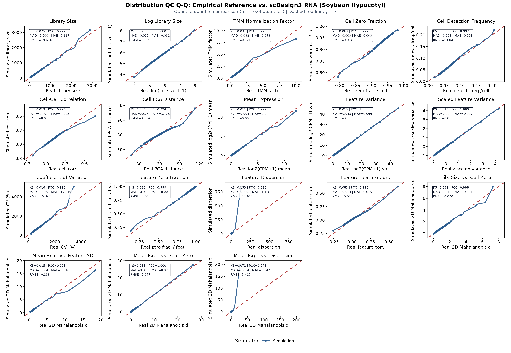
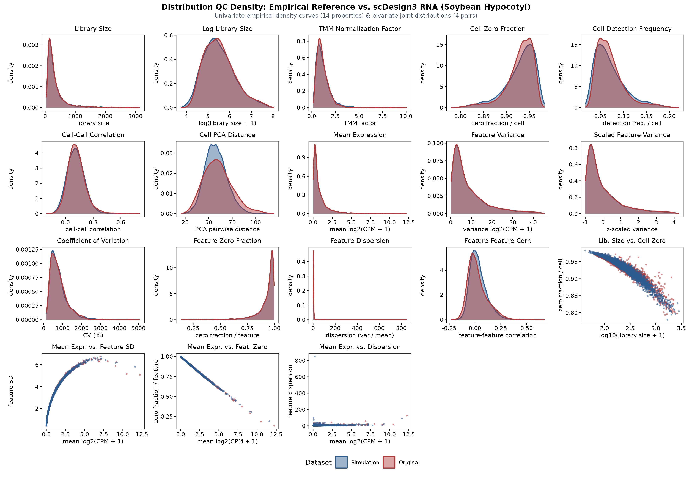
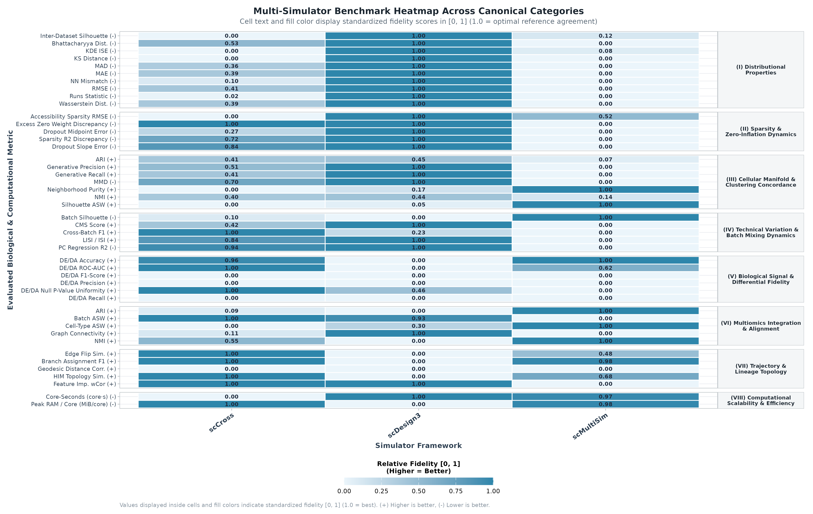
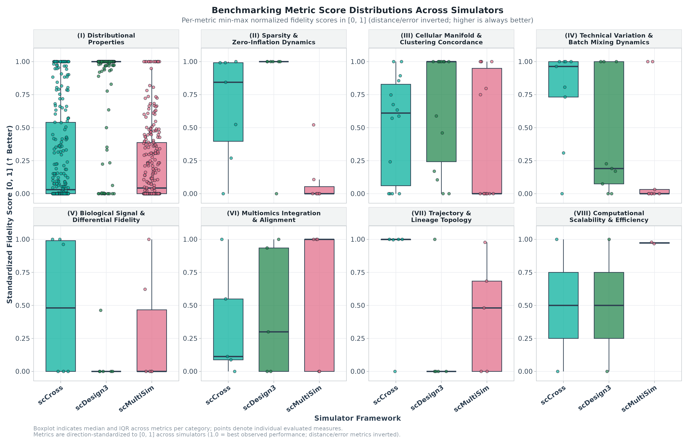
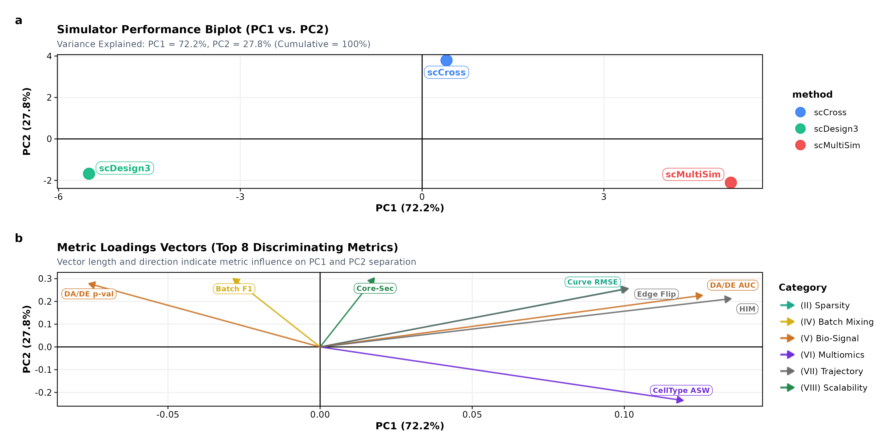
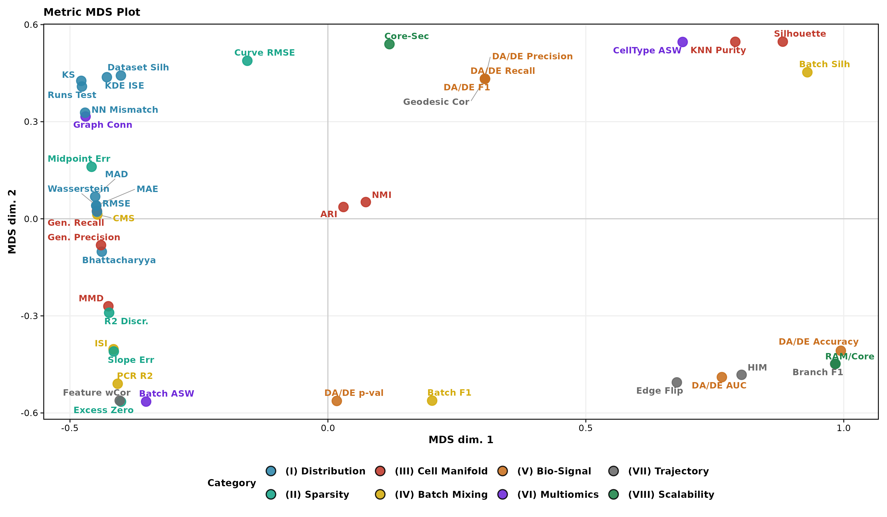
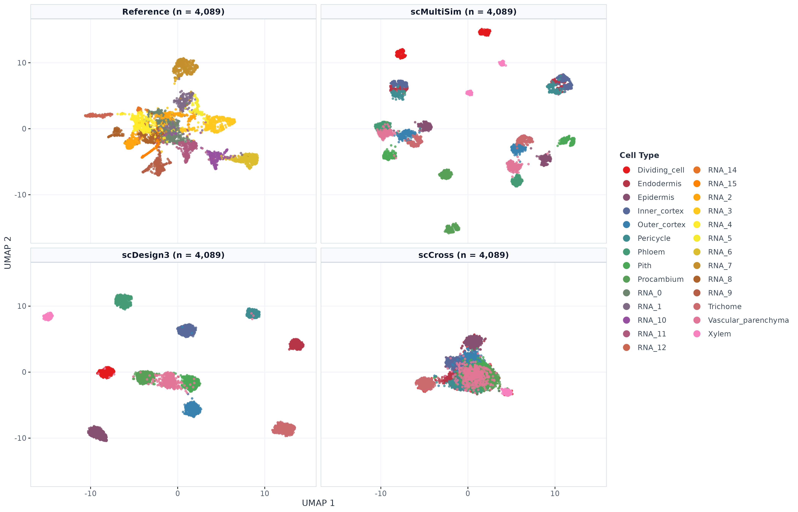
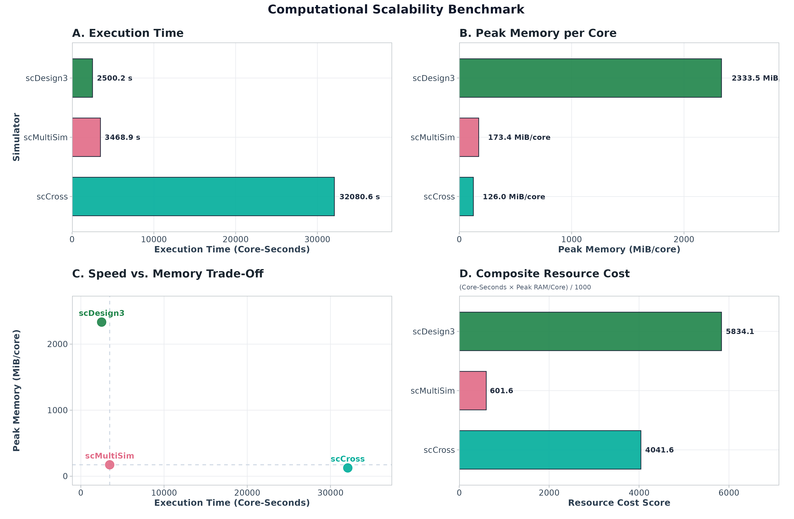

```{r knitr-setup, include = FALSE}
knitr::opts_chunk$set(
  collapse = TRUE,
  comment  = "#>",
  fig.width  = 10,
  fig.height = 6,
  warning  = FALSE,
  message  = FALSE
)
```

# Introduction

In **unpaired single-cell multiomics** designs, gene expression (scRNA-seq) and chromatin accessibility (scATAC-seq) are profiled from **separate, non-overlapping populations of single cells** harvested from the same biological tissue or sibling aliquots. Unlike paired co-assays, cell barcode $i$ in the RNA count matrix does **not** correspond to cell barcode $i$ in the ATAC matrix, and the two modalities frequently differ in total cell count, batch structure, and annotation granularity.

Simulating and evaluating unpaired multiomics introduces distinct methodological requirements:
* **Unequal Cell Counts & Independent Barcodes:** Evaluators must compare RNA and ATAC layers independently without assuming 1-to-1 cell correspondence.
* **Shared-Manifold Alignment Without Cell Pairing:** Cross-modality coherence (Category VI) is assessed at the shared biological population and integrated latent embedding level (joint cell-type alignment, batch mixing, and graph connectivity) rather than direct cell-to-cell feature pairing.
* **Modality-Specific Scalability Accounting:** Some simulators (`scMultiSim`, `scCross`) simulate both modalities in a single unified run, whereas modular frameworks (`scDesign3`) fit and simulate scRNA-seq and scATAC-seq in separate jobs with distinct CPU core allocations and memory footprints. `scSimEval` natively supports both combined and modality-separated resource tracking.

**`scSimEval`** handles unpaired designs automatically when `is_paired = FALSE` in `evaluate_multiomics_accuracy()`, evaluating all **8 active categories**:
1. **Category I: Distributional Properties** — Independent univariate distributional distances across RNA genes and ATAC peaks.
2. **Category II: Sparsity & Zero-Inflation Dynamics** — Logistic dropout modeling for RNA and quadratic accessibility-sparsity curve fitting for ATAC.
3. **Category III: Cellular Manifold & Clustering Concordance** — Modality-specific manifold geometry, MMD, Generative Precision & Recall, ASW, ARI, and NMI.
4. **Category IV: Technical Variation & Batch Mixing Dynamics** — Batch Silhouette Width, Principal Component Regression ($PCR\ R^2$), CMS, and ISI per modality.
5. **Category V: Biological Signal & Differential Fidelity** — Pseudobulk `edgeR-QLF` differentially expressed genes (DEG) and differentially accessible peaks (DA).
6. **Category VI: Multiomics Integration & Alignment** — Cross-modality latent space alignment, joint Cell-Type ASW, joint Batch ASW, and within-cell-type graph connectivity on integrated embeddings.
7. **Category VII: Trajectory & Lineage Topology** — Transcriptomic lineage topology (HIM, edge-flip, geodesic correlation, and branch F1).
8. **Category VIII: Computational Scalability & Efficiency** — Hardware-normalized `core_seconds` and `memory_per_core_mib`, supporting both unified and modality-separated (`RNA` + `ATAC`) execution logs.

---

# 1. Input Data Requirements & Case Study Setup

For unpaired evaluation, `scSimEval` accepts modality-indexed lists for count objects, cell-type labels, and batch identifiers:
* `ref_multi = list(RNA = ref_rna_obj, ATAC = ref_atac_obj)` (independent cell barcodes and counts)
* `sim_multi = list(RNA = sim_rna_obj, ATAC = sim_atac_obj)`
* `cell_types = list(RNA = ct_rna, ATAC = ct_atac)` and `batch_info = list(RNA = bt_rna, ATAC = bt_atac)`

### Case Study: Soybean Hypocotyl Unpaired Multiomics (3 Simulators)

We benchmark **3 single-cell multiomics simulators** on an empirical unpaired **Soybean Hypocotyl** (*Glycine max*) dataset:
* **scRNA-seq Reference:** 2,000 genes $\times$ 4,089 cells across 15 cell types and 2 biological batches (92.91% sparsity).
* **scATAC-seq Reference:** 6,000 peaks $\times$ 6,093 cells across 3 biological batches (82.44% sparsity).

The 3 evaluated simulators and their empirical HPC resource logs are summarized below:

| Simulator | Execution Mode | Wall-Clock Runtime (s) | Peak Resident Memory | CPU Cores |
|:---|:---|:---:|:---:|:---:|
| **scMultiSim** | Combined (RNA + ATAC) | 216.80 | 2,774.70 MiB | 16 |
| **scDesign3** | Separate (RNA / ATAC) | 89.19 (RNA) / 268.28 (ATAC) | 2,190.40 MiB (RNA) / 9,334.00 MiB (ATAC) | 16 (RNA) / 4 (ATAC) |
| **scCross** | Combined (RNA + ATAC) | 2,005.04 | 2,113.62 MB | 16 |

---

# 2. Running the Unpaired Multiomics Benchmarking Pipeline

Setting `is_paired = FALSE` in `evaluate_multiomics_accuracy()` activates independent modality evaluation and unpaired joint-embedding integration scoring. Below is the exact workflow demonstrating both combined (`scMultiSim`, `scCross`) and modality-separated (`scDesign3`) resource logging:

```r
library(scSimEval)

# Validate empirical reference (extracts independent RNA and ATAC assays + metadata)
ref_val <- validate_multiomics_input(
  readRDS("soy_hypocotyl_reference_integrated_combined.rds"),
  "Soybean Hypocotyl (Unpaired)"
)

eval_ct <- list(RNA = ref_val$cell_types$RNA, ATAC = ref_val$cell_types$ATAC)
eval_bt <- list(RNA = ref_val$batch_info$RNA, ATAC = ref_val$batch_info$ATAC)

# Example A: Combined resource tracking (scMultiSim / scCross)
eval_scmultisim <- evaluate_multiomics_accuracy(
  ref_multi         = list(RNA = ref_val$m1_obj, ATAC = ref_val$m2_obj),
  sim_multi         = list(RNA = sim_val$m1_obj, ATAC = sim_val$m2_obj),
  is_paired         = FALSE,
  cell_types        = eval_ct,
  batch_info        = eval_bt,
  elapsed_time      = 216.804,
  time_unit         = "seconds",
  memory_mb         = 2774.70,
  memory_unit       = "MiB",
  sim_cores         = 16L,
  compute_bivariate = FALSE,
  threads           = 16L,
  verbose           = FALSE
)

# Example B: Separate modality resource tracking (scDesign3)
eval_scdesign3 <- evaluate_multiomics_accuracy(
  ref_multi         = list(RNA = ref_val$m1_obj, ATAC = ref_val$m2_obj),
  sim_multi         = list(RNA = sim_d3$m1_obj,  ATAC = sim_d3$m2_obj),
  is_paired         = FALSE,
  cell_types        = eval_ct,
  batch_info        = eval_bt,
  elapsed_time_rna  = 89.19,   elapsed_time_atac = 268.28,
  memory_mb_rna     = 2190.40, memory_mb_atac    = 9334.00,
  time_unit_rna     = "seconds", time_unit_atac  = "seconds",
  memory_unit_rna   = "MiB",     memory_unit_atac = "MiB",
  sim_cores_rna     = 16L,       sim_cores_atac  = 4L,
  compute_bivariate = FALSE,
  threads           = 16L,
  verbose           = FALSE
)
```

---

# 3. Inspecting Unpaired Benchmark Results Across Categories

```{r load-results, echo = FALSE}
res_file <- "unpaired_benchmark_results.rds"
if (!file.exists(res_file)) {
  res_file <- "/root/scSimEval_analysis/demo_analysis/unpaired_soy_hypocotyl/scSimEval_benchmark_results.rds"
}
final_benchmark_df <- readRDS(res_file)
```

### Overall Fidelity Leaderboard

Aggregating direction-aware normalized scores across all 8 evaluation categories ranks the 3 candidate simulators on Soybean Hypocotyl unpaired multiomics:

```{r leaderboard}
df_norm <- scSimEval:::.normalize_bubble_scores(final_benchmark_df)
agg <- stats::aggregate(Score_Norm ~ Method + Category, data = df_norm, FUN = mean, na.rm = TRUE)
leaderboard <- stats::aggregate(Score_Norm ~ Method, data = agg, FUN = mean, na.rm = TRUE)
leaderboard <- leaderboard[order(leaderboard$Score_Norm, decreasing = TRUE), ]
leaderboard$Rank <- seq_len(nrow(leaderboard))
leaderboard$Average_Fidelity <- sprintf("%.1f%%", leaderboard$Score_Norm * 100)
leaderboard[, c("Rank", "Method", "Average_Fidelity", "Score_Norm")]
```

### Category-Level Score Matrix

Inspecting mean normalized fidelity across each of the 8 categories highlights the complementary trade-offs among simulators:

```{r category-matrix}
cat_mat <- reshape(agg, idvar = "Category", timevar = "Method", direction = "wide")
colnames(cat_mat) <- sub("^Score_Norm\\.", "", colnames(cat_mat))
cat_mat[, -1] <- round(cat_mat[, -1], 4)
cat_mat
```

### Representative Category Inspections

```{r cat-inspect}
# Category I: Distributional Properties (RNA & ATAC)
head(subset(final_benchmark_df, grepl("Distributional", Category))[, c("Method", "Modality", "Property", "Metric", "Value", "Score")], 6)

# Category VI: Unpaired Multiomics Integration & Alignment
subset(final_benchmark_df, grepl("Multiomics Integration", Category))[, c("Method", "Property", "Metric", "Value", "Score")]

# Category VIII: Computational Scalability & Efficiency
subset(final_benchmark_df, grepl("Scalability", Category))[, c("Method", "Modality", "Property", "Metric", "Value", "Score")]
```

---

# 4. Publication-Grade Comparative Visualizations

### 4.1 Comparative Bubble Matrix

```r
p_bubble <- plot_benchmark_bubble_matrix(final_benchmark_df, base_size = 12)
ggsave("figures/unpaired_benchmark_bubble_matrix.png", plot = p_bubble, width = 18, height = 8.5, dpi = 300)
```

```{r fig-bubble, echo = FALSE, out.width = "100%", fig.cap = "**Figure 1: Comparative Bubble Matrix across Unpaired Multiomics Evaluation Metrics.** Visualizes direction-aware normalized fidelity scores across all 8 active categories for scCross, scDesign3, and scMultiSim on Soybean Hypocotyl."}

```

---

### 4.2 Evaluation Summary Visualization

```r
p_summary <- plot_evaluation_summary(final_benchmark_df, normalize_scores = TRUE, base_size = 11)
ggsave("figures/unpaired_evaluation_summary.png", plot = p_summary, width = 14, height = 7, dpi = 300)
```

```{r fig-summary, echo = FALSE, out.width = "100%", fig.cap = "**Figure 2: Overall Simulator Evaluation Summary.** Polar chart comparing category-level composite fidelity across all 8 evaluation dimensions."}

```

---

### 4.3 Distribution QC Diagnostics: Q-Q Plots and Empirical Density

```r
p_qc_qq <- plot_distribution_qc(
  ref_data = ref_rna,
  sim_data = sim_rna_scdesign3,
  layout   = "qq",
  title    = "Distribution QC Q-Q: Empirical Reference vs. scDesign3 RNA (Soybean Hypocotyl)"
)
ggsave("figures/unpaired_distribution_qc_qq.png", plot = p_qc_qq, width = 13, height = 9, dpi = 300)

p_qc_density <- plot_distribution_qc(
  ref_data = ref_rna,
  sim_data = sim_rna_scdesign3,
  layout   = "density",
  title    = "Distribution QC Density: Empirical Reference vs. scDesign3 RNA (Soybean Hypocotyl)"
)
ggsave("figures/unpaired_distribution_qc_density.png", plot = p_qc_density, width = 13, height = 9, dpi = 300)
```

```{r fig-qc-qq, echo = FALSE, out.width = "100%", fig.cap = "**Figure 3A: Distribution QC Quantile-Quantile (Q-Q) Diagnostics.** Compares marginal library size, detection rate, feature mean, and feature variance quantiles between empirical Soybean Hypocotyl RNA and scDesign3."}

```

```{r fig-qc-density, echo = FALSE, out.width = "100%", fig.cap = "**Figure 3B: Distribution QC Empirical Density Overlays.** Overlays empirical probability densities across marginal count properties."}

```

---

### 4.4 Metric Heatmap

```r
p_heatmap <- plot_metric_heatmap(final_benchmark_df, scale_fill = "relative", base_size = 10)
ggsave("figures/unpaired_metric_heatmap.png", plot = p_heatmap, width = 15, height = 9.5, dpi = 300)
```

```{r fig-heatmap, echo = FALSE, out.width = "100%", fig.cap = "**Figure 4: Relative Metric Heatmap.** Hierarchically clustered relative fidelity scores across all evaluated RNA, ATAC, and cross-modal integration metrics."}

```

---

### 4.5 Metric Score Distributions Across Categories (Multi-Panel Boxplots)

```r
p_boxplots <- plot_metric_boxplots(final_benchmark_df, score_type = "normalized", base_size = 11)
ggsave("figures/unpaired_metric_boxplots.png", plot = p_boxplots, width = 14, height = 9, dpi = 300)
```

```{r fig-boxplots, echo = FALSE, out.width = "100%", fig.cap = "**Figure 5: Metric Score Distributions Across Evaluation Categories.** Multi-panel boxplot showing score distributions and medians across all 8 evaluation categories."}

```

---

### 4.6 Principal Component Analysis (PCA) Ordination

```r
p_pca <- plot_metric_pca(final_benchmark_df, panel = "both", top_n_loadings = 8, base_size = 11)
ggsave("figures/unpaired_pca_ordination.png", plot = p_pca, width = 13, height = 6.5, dpi = 300)
```

```{r fig-pca, echo = FALSE, out.width = "100%", fig.cap = "**Figure 6: PCA Ordination Biplot.** Joint projection of simulators and top 8 influential metric loadings explaining performance variance."}

```

---

### 4.7 Multidimensional Scaling (MDS) Metric Space

```r
p_mds <- plot_metric_mds(final_benchmark_df, ordination_by = "summaries", normalize_scores = TRUE, base_size = 11)
ggsave("figures/unpaired_mds_metric_space.png", plot = p_mds, width = 12, height = 7, dpi = 300)
```

```{r fig-mds, echo = FALSE, out.width = "100%", fig.cap = "**Figure 7: Multidimensional Scaling (MDS) Metric Space.** Visualizes global pairwise proximity among simulators based on summary metric profiles."}

```

---

### 4.8 UMAP Embeddings Grid Across Simulators

```r
embedding_df <- compute_dataset_embeddings(
  reference  = ref_rna,
  simulated  = list_of_sim_rna_counts,
  reduction  = "umap",
  cell_types = list_of_rna_cell_types,
  seed       = 42
)

p_umap <- plot_dataset_embeddings(
  embedding_data = embedding_df,
  reduction      = "umap",
  layout         = "facet",
  color_by       = "cell_type",
  base_size      = 11
)
ggsave("figures/unpaired_umap_grid.png", plot = p_umap, width = 14, height = 9, dpi = 300)
```

```{r fig-umap, echo = FALSE, out.width = "100%", fig.cap = "**Figure 8: Faceted UMAP Embeddings Grid.** Compares 2D cellular manifold structure across the empirical Soybean Hypocotyl reference and all 3 simulators, colored by cell type."}

```

---

### 4.9 Computational Scalability Benchmark (Combined 4-Panel)

```r
p_scalability <- plot_scalability_benchmark(
  benchmark_data = final_benchmark_df,
  type           = "composite",
  layout         = "4panel",
  modality       = "total",
  time_unit      = "core_seconds",
  memory_unit    = "MiB/core",
  base_size      = 11
)
ggsave("figures/unpaired_scalability_benchmark.png", plot = p_scalability, width = 13, height = 8.5, dpi = 300)
```

```{r fig-scalability, echo = FALSE, out.width = "100%", fig.cap = "**Figure 9: Composite 4-Panel Computational Scalability Benchmark.** Evaluates cumulative core-seconds runtime, peak resident memory per core (MiB/core), cell throughput, and speed-memory trade-offs."}

```

---

# 5. Context-Specific Insights & Simulator Recommendations

Evaluating unpaired Soybean Hypocotyl multiomics highlights distinct strengths across methodological families:

* **Best Overall Balance (`scCross`, 54.4%):** Led the overall leaderboard by achieving top scores in **Trajectory & Lineage Topology** (0.799), **Batch Mixing Dynamics** (0.757), and **Differential Signal Fidelity** (0.494), though at a substantially higher runtime cost (2,005 s across 16 cores).
* **Highest Marginal & Manifold Fidelity (`scDesign3`, 51.0%):** Dominated **Distributional Properties** (0.923), **Sparsity & Zero-Inflation Dynamics** (0.857), and **Cellular Manifold Concordance** (0.666), matching empirical RNA sparsity (92.92% vs. 92.91%) and ATAC median library size (2,102 vs. 2,096) with high precision. Because it fits RNA and ATAC separately, ATAC simulation requires higher per-core RAM (9,334 MiB across 4 cores).
* **Best Scalability & Unpaired Integration (`scMultiSim`, 40.1%):** Achieved the highest **Computational Scalability** score (0.973; 216.8 s combined runtime) and strongest **Unpaired Multiomics Integration & Alignment** score (0.600), making it well-suited for rapid cross-modal integration benchmarking.

---

# 6. Session Information

```{r session-info}
sessionInfo()
```
