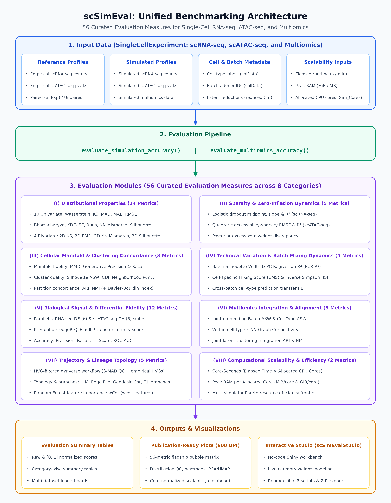

```{r knitr-setup, include = FALSE}
knitr::opts_chunk$set(
  collapse = TRUE,
  comment = "#>",
  fig.width = 7,
  fig.height = 5,
  warning = FALSE,
  message = FALSE
)
```

## 1. What Do the 8 Evaluation Categories Measure? (56 Metrics)

Each category answers one simple question about how realistic a simulated dataset is:

| Category | # Metrics | Data Needed | What Question Does It Answer? (and What It Measures) |
| :--- | :---: | :--- | :--- |
| **I. Distributional Properties** | **14** | Count matrix only | **Do the simulated cell and gene/peak count distributions match real data?**<br>10 univariate & 4 bivariate distributional similarity measures (Wasserstein, KS, MAD, Bhattacharyya, Runs test, NN mismatch, Silhouette, 2D KS, 2D EMD, 2D NN mismatch, 2D Silhouette) across 7 cell-level, 7 feature-level, and 4 bivariate properties. |
| **II. Sparsity & Zero-Inflation Dynamics** | **5** | Count matrix only | **Are zero counts and dropout rates realistic across genes/peaks and cells?**<br>Logistic dropout curve fidelity (midpoint error $x_0$, transition slope error $k$, goodness-of-fit $R^2$), quadratic accessibility-sparsity RMSE & $R^2$ (scATAC-seq), and excess zero proportion difference. |
| **III. Cellular Manifold & Clustering Concordance** | **8** | Uses `cell_type` | **Do simulated cells form the right cell-type clusters and neighborhood structures?**<br>Maximum Mean Discrepancy (MMD), Generative Precision & Recall, Average Silhouette Width (ASW), Clustering Deviation Index (CDI), Neighborhood Purity, Adjusted Rand Index (ARI), and Normalized Mutual Information (NMI). |
| **IV. Technical Variation & Batch Mixing Dynamics** | **5** | Uses `batch` | **Are technical batch differences reproduced properly across batches?**<br>Batch Silhouette Width, Principal Component Regression ($PCR\ R^2$), Cell-Specific Mixing Score (CMS), Inverse Simpson's Index (ISI), and Cross-Batch F1 Score. |
| **V. Biological Signal & Differential Fidelity** | **12** | Uses `cell_type` | **Can we still detect true marker genes (DEGs) and accessible chromatin peaks (DARs)?**<br>Pseudobulk `edgeR-QLF` differential testing for scRNA-seq DE (6 metrics) and scATAC-seq DA (6 metrics): $p$-value uniformity, accuracy, precision, recall, F1-score, and ROC-AUC. |
| **VI. Multiomics Integration & Alignment** | **5** | Paired / Unpaired Multiomics | **Do simulated RNA and ATAC modalities align and integrate well together?**<br>Joint-embedding integration quality: Batch ASW, Cell-Type ASW, $k$-NN Graph Connectivity, Integration ARI, and Integration NMI. |
| **VII. Trajectory & Lineage Topology** | **5** | scRNA-seq counts | **Are cell developmental paths, branches, and trajectory genes preserved?**<br>HVG-filtered dynverse workflow on scRNA-seq: HIM topology similarity, edge-flip similarity, geodesic distance correlation, branch assignment F1 (`F1_branches`), and RF feature importance correlation (`wcor_features`). |
| **VIII. Computational Scalability & Efficiency** | **2** | Runtime & RAM inputs | **How fast and memory-light is each simulator?**<br>Core-normalized runtime (`core_seconds`) and memory per allocated core (`memory_per_core_mib`), alongside wall-clock elapsed time (s / min) and total peak RAM (MiB / GiB). |

> **Curated Metric Measurement Capacity by Modality:**
> - **scRNA-seq:** **44 Metrics** across 7 categories (Cat I: 14, Cat II: 4, Cat III: 8, Cat IV: 5, Cat V: 6 DE, Cat VII: 5 Trajectory, Cat VIII: 2 Scalability).
> - **scATAC-seq:** **38 Metrics** across 6 categories (Cat I: 14, Cat II: 3, Cat III: 8, Cat IV: 5, Cat V: 6 DA, Cat VIII: 2 Scalability; Trajectory skipped for ATAC).
> - **Paired Multiomics:** **56 Metrics** across all 8 canonical categories (I–VIII, with 50 unique columns in Comparative Bubble Matrix).
> - **Unpaired Multiomics:** **56 Metrics** across all 8 canonical categories (same 56 metrics, with Cat VI integration evaluated on joint stacked embeddings).

```{r workflow-overview, echo=FALSE, fig.align='center', out.width='100%', fig.cap='**Figure 1: Unified benchmarking architecture of scSimEval.** The end-to-end framework ingests reference and simulated single-cell and multiomics count matrices with experimental metadata, evaluates 56 curated evaluation measures across eight biological and computational dimensions, standardizes scores via direction-aware normalization, and generates publication-grade comparative visualizations and leaderboards.'}

```

---

## 2. Input Data Formats & Metadata Requirements

In `scSimEval`, reference and simulated datasets can be supplied as either standard count matrices with metadata vectors or encapsulated as S4 objects (`Seurat` or `SingleCellExperiment` saved as `.rds` files):

1. **Count Matrices (`ref_data`, `sim_data`):**
   - **Dimensions:** Features (Genes or ATAC Peaks) in **rows** $\times$ Cells in **columns**.
   - **Data Types:** Sparse matrices (`dgCMatrix`), standard numeric matrices, `data.frame`, or embedded inside `Seurat` / `SingleCellExperiment` objects.

2. **Cell-Type Annotations (`cell_types` — Mandatory):**
   - Character vector or factor matching cell columns.
   - Required for cellular manifold concordance (Category III: ARI, NMI, Silhouette width), biological signal fidelity (Category V: DEGs and DARs), and cross-batch cell type transfer F1.

3. **Batch Identifiers (`batch_info` — Mandatory):**
   - Character vector or factor matching cell columns.
   - Required for technical variation and batch mixing dynamics (Category IV: CMS, ISI, PCR $R^2$, Batch Silhouette) and pseudobulk biological replicate modeling (Category V: `edgeR-QLF`).

4. **Computational Resource Logs (Optional / Category VIII):**
   - Standardized execution runtime (`core_seconds`) and resident memory footprint per core (`memory_per_core_mib`) to benchmark computational scalability and algorithmic efficiency.

---

## 3. Modality-Specific Metrics & Object Guidelines (Seurat / SingleCellExperiment)

In `scSimEval`, reference and simulated datasets are uploaded as standard `Seurat` or `SingleCellExperiment` S4 objects (`.rds`). Providing `cell_type` and `batch` metadata annotations enables complete benchmarking across all biological clustering, batch mixing, and differential signal evaluation categories (embedded directly in `meta.data` in Seurat or `colData` in SingleCellExperiment):

### Quantitative Metric Measurement Capacity by Modality

When both `cell_type` and `batch` metadata are provided, `scSimEval` evaluates the full suite of curated metrics tailored for each analysis modality:

| Modality / Analysis Option | Exact Metrics Evaluated | Active Evaluation Categories & Scope |
| :--- | :---: | :--- |
| **1. scRNA-seq** | **44 Metrics** | **7 Categories:** Distributional Properties (14), Sparsity & Dropout (4), Clustering Concordance (8), Batch Mixing Dynamics (5), edgeR-QLF DE Signal (6), dynverse Trajectory (5), and Computational Scalability (2). |
| **2. scATAC-seq** | **38 Metrics** | **6 Categories:** Distributional Properties (14), Sparsity & Dropout (3), Clustering Concordance (8), Batch Mixing Dynamics (5), edgeR-QLF DA Signal (6), and Computational Scalability (2). *(Trajectory [Cat VII] is skipped for ATAC).* |
| **3. Paired Multiomics** | **56 Metrics**<br>*(50 Plot Columns)* | **All 8 Categories:** Distributional Properties (14), Sparsity & Dropout (5), Clustering Concordance (8), Batch Mixing Dynamics (5), Differential Signal (12: 6 DE + 6 DA), Multiomics Integration (5), Trajectory (5), and Computational Scalability (2). |
| **4. Unpaired Multiomics** | **56 Metrics**<br>*(50 Plot Columns)* | **All 8 Categories:** Evaluates the exact same 56 metrics across all 8 categories as paired multiomics. Category VI multiomics integration is evaluated on joint stacked embeddings. |

### Object Setup Guidelines

```r
# 1. Seurat Object Setup (.rds)
# Embed annotations in meta.data or via standard column assignment:
seurat_obj$cell_type <- cell_types_vector   # Enables Cat III, V, VI
seurat_obj$batch     <- batch_vector        # Enables Cat IV & V

# Save for scSimEval analysis
saveRDS(seurat_obj, file = "dataset.rds")

# 2. SingleCellExperiment Setup (.rds)
# Embed annotations in colData:
colData(sce)$cell_type <- cell_types_vector # Enables Cat III, V, VI
colData(sce)$batch     <- batch_vector      # Enables Cat IV & V

# Save for scSimEval analysis
saveRDS(sce, file = "dataset.rds")
```

---

## 4. Complete Pipeline Core Allocation Table (All 8 Categories)

| Pipeline Step / Category | Cores Used | Exact Reason |
| :--- | :---: | :--- |
| **Property Extraction** | 4 cores | Exactly 4 matrices exist: Ref Cells, Sim Cells, Ref Features, Sim Features. |
| **Category I (Distributional Metrics)** | 20 cores | 140+ metric-property combinations split across all cores. |
| **Category II & III (Dropout, MMD, Gen-PR)** | 5 cores | Exactly 5 distinct mathematical algorithms run in parallel. |
| **Category IV (Batch Integration & Mixing)** | 2 cores (if 2 batches) | Number of batches $B = 2 \implies$ only $B(B-1) = 2$ cross-batch transfer pairs exist ($1 \to 2$ and $2 \to 1$). |
| **Category V (DE / DA Pseudobulk Fidelity)** | 20 cores | Thousands of genes and peaks tested in parallel via `edgeR-QLF`. |
| **Category VI (Multiomics Integration & Alignment)** | Adaptive (4 to 20 cores) | Runs on joint low-dim space; ASW scales to all 20 cores, and graph connectivity runs in fast C++ via `RANN`. *(Multiomics mode only)* |
| **Category VII (Trajectory & Dynverse)** | 20 cores | Random Forest trees (`ranger`) and geodesic distances scale across all cores. |
| **Category VIII (Computational Scalability)** | 1 core | Measures wall-clock runtime (`core_seconds`) and peak resident memory (RAM MiB). |

---

## 5. Bundled Example Datasets & Shiny Data Modes

`scSimEval` ships with lightweight, real plant single-cell example datasets (`data()` and Shiny Studio Data Modes 1–4) derived from empirical Rice Bud and Soybean Root multiomics references:

| Shiny Data Mode | Package Dataset | Tissue & Scope | Dimensions | Simulators Included |
| :--- | :--- | :--- | :--- | :--- |
| **Mode 1: scRNA-seq** | `example_rice_bud$reference$rna` / `example_scrna` | Rice Bud paired scRNA-seq | 100 balanced cells (8 cell types) $\times$ top 100 HVGs | 6 (`scMultiSim`, `scDesign3`, `MOSim`, `scCross`, `scMoMtF`, `Matilda`) |
| **Mode 2: scATAC-seq** | `example_rice_bud$reference$atac` / `example_scatac` | Rice Bud paired scATAC-seq | 100 balanced cells (8 cell types) $\times$ top 100 HVPs | 6 (`scMultiSim`, `scDesign3`, `MOSim`, `scCross`, `scMoMtF`, `Matilda`) |
| **Mode 3: Paired Multiomics** | `example_rice_bud` / `example_multiomics` | Rice Bud paired RNA + ATAC | 100 identical paired cells $\times$ 100 HVGs + 100 HVPs | 6 (`scMultiSim`, `scDesign3`, `MOSim`, `scCross`, `scMoMtF`, `Matilda`) |
| **Mode 3: Unpaired Multiomics** | `example_soybean_root` | Soybean Root unpaired RNA + ATAC | 100 RNA cells $\times$ 100 HVGs; 100 ATAC cells $\times$ 100 HVPs (8 cell types) | 3 (`scMultiSim`, `scDesign3`, `scCross`) |
| **Mode 4: Upload Saved Results** | `demo_paired_multiomics_saved.rds` | Pre-computed Rice Bud Paired session | 6 simulators, 1,950 evaluated metric rows | Instant zero-latency leaderboard & visualization reload |


